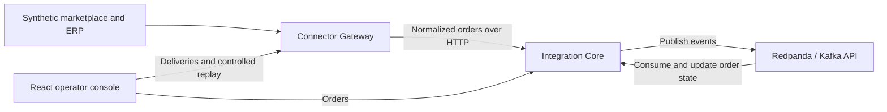

# Commerce Integration Hub

A local demonstration of receiving orders from different systems, converting
them to a common format and following their processing through an operator
console. It handles duplicate requests, conflicting payloads and temporary
service failures without replacing previously accepted orders.

It is intended for integration operators inspecting orders and deliveries, and
engineers investigating failures. The external providers and order data are
synthetic. See the [product overview](docs/product-overview.md) for the full scope.

## How it works

A fictional marketplace sends signed webhooks; a fictional ERP exposes an order
API that the Connector Gateway polls. The Gateway records deliveries in its own
PostgreSQL database, normalizes the data and forwards orders to the Integration
Core over HTTP. Sources can also submit the common order format directly to the
Core using a source API key.

The Core saves each new order and its pending event in one transaction. It
publishes events through Redpanda using the Kafka API. A consumer inside the
Core records processing, moves the order to `READY` and creates an `OrderReady`
event. The optional OpenSearch projection supports order search.



For example, sending the same order again returns the existing order. Reusing
its external identifier with different content returns a conflict. The console
shows the order timeline and Gateway delivery attempts so an operator can
investigate what happened. See the [sequence diagrams](docs/ingestion-sequences.md)
for the transaction boundaries.

## Local demo

Prerequisites are JDK 25, Docker with the Compose plugin, Node.js 24 or newer
(below 27), and pnpm 11.23.0. The Maven Wrapper is included.

From the repository root, build the Core and start the base stack:

```bash
cd services/integration-core
./mvnw package -DskipTests
cd ../..
docker compose up --build --wait
```

Follow the [Core demo](services/integration-core/README.md#local-demo) to
provision a source API key and submit the example orders. In another terminal,
starting from the repository root, run the console:

```bash
cd apps/operator-console
pnpm install --frozen-lockfile
pnpm dev
```

Open [http://localhost:5173](http://localhost:5173). The simulator uses the
provisioned source API key; the Orders page reads the saved order state. The
base stack runs the Core, PostgreSQL, Redpanda and Redpanda Console. The Gateway,
search and observability paths require explicit configuration.

The [local demo guide](docs/local-demo.md) covers these optional paths and how
to stop the stack. The [Kubernetes guide](deploy/README.md) covers the separate
local cluster, service mesh, database failover and failure scenarios.

## Main capabilities

- Signed webhook receipt and scheduled polling of synthetic providers, with
  durable delivery records and bounded forwarding retries.
- Source API keys, source-owned order access, duplicate detection and conflict
  rejection.
- Atomic order and event persistence, event deduplication and dead-letter
  routing for processing failures.
- An operator console with order timelines, delivery attempts, optional search,
  recorded integration scenarios and a static interactive architecture map.
- Optional external operator JWT validation and an audited `platform-admin`
  command to retry eligible exhausted Gateway deliveries.
- Metrics, structured logs, optional OpenTelemetry tracing and Jaeger, and
  local dashboards and tested alert rules.
- An optional local Kubernetes environment with replicas on different nodes,
  synchronous PostgreSQL replication, Istio ambient mesh and failure checks.

The [capability table](docs/product-overview.md#capability-status) distinguishes
implemented behavior from planned work. The current repository version is
`1.2.0`; its [release notes](docs/releases/v1.2.0.md) record the verification
and defects found through failure testing. Earlier milestones are listed in
the [release index](docs/releases/README.md#published-releases).

## Limits

This is a local demo with development credentials. Operator authorization is
disabled by default; login and identity-provider deployment are not included.
Gateway forwarding needs a provisioned Core credential, and polling is opt-in.

PostgreSQL is authoritative; OpenSearch is a rebuildable search index. External
event subscribers, outbox/dead-letter replay and automated Gateway payload
cleanup are not implemented. The local cluster runs on one machine, and the
project makes no production availability, throughput or latency claim.
Read [current limitations](docs/limitations.md) before assuming wider support.

## Technologies

Kotlin and Quarkus on Java 25 for the Core; Node.js, TypeScript and Fastify for
the Gateway; React and TypeScript for the console. Each service owns a separate
PostgreSQL database. Redpanda provides the Kafka-compatible broker, with
OpenSearch, Prometheus, Grafana, OpenTelemetry and Jaeger available as optional
local integrations. Docker Compose runs the demo; kind, Helm, CloudNativePG and
Istio support the optional Kubernetes environment.

## Repository structure

```text
apps/operator-console/    React operator UI
services/connector-gateway/ Provider adapters and durable delivery state
services/integration-core/ Canonical orders and event processing
tools/provider-simulator/ Synthetic external provider
docs/                     Product, architecture, demo and development guides
deploy/                   Optional local Kubernetes environment
observability/            Metrics, alerts, dashboards and tracing configuration
scripts/                  Verification and local environment tools
```

## Build

The [development guide](docs/development.md) contains module checks, API type
validation, deployment checks and browser-test instructions. Service-specific
details are in the [Core](services/integration-core/README.md),
[Gateway](services/connector-gateway/README.md) and
[console](apps/operator-console/README.md) READMEs.

## Security verification

The [security verification guide](docs/development.md#security-verification)
documents Git-history secret scanning, scheduled image scans and dependency
updates. Verification results apply to the recorded build and scan, not future
dependency changes.

For the complete reading path, see the [documentation index](docs/README.md),
[architecture decisions](docs/decisions/README.md) and
[release process](docs/releases/README.md).

## License

Licensed under the MIT License. See [LICENSE](LICENSE).
