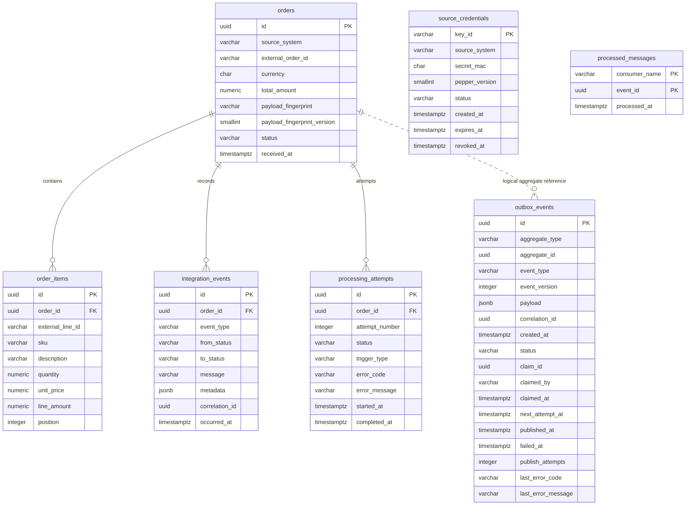
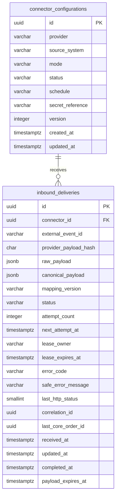

# Relational Data Model

The first diagram describes the PostgreSQL schema owned by the Integration
Core. Flyway migrations remain its authoritative schema definition.

`orders.source_system` and `orders.external_order_id` form one composite unique
key. The two unique constraints on `order_items` combine `order_id` with
`position` and with a non-null `external_line_id`, respectively.

`integration_events.order_id` is a physical foreign key with cascading deletion.
`outbox_events.aggregate_id` is deliberately a logical reference rather than a
foreign key because the outbox is structured to carry events for different
aggregate types. The current schema restricts `aggregate_type` to `ORDER`.
Outbox claim fields are present only while an event is `PUBLISHING`. A terminal
`FAILED` event requires `failed_at`, `last_error_code`, and a safe error message.

`source_credentials` stores a credential identifier, its source identity, a
lowercase HMAC-SHA-256 MAC, and the pepper version needed for verification. Its
constraints keep status, expiry, and revocation timestamps consistent. See
[ADR 0001](decisions/0001-source-api-key-authentication.md) for the authentication
and rotation decision. Order endpoints authenticate against these credentials
and use the resulting source identity to constrain order access.

`processed_messages` is the consumer inbox. Its composite primary key allows
independent consumers to process the same event while rejecting another effect
for the same consumer and event ID. It has no foreign key to `outbox_events`
because consumed events belong to the messaging boundary and may originate from
another service. The table exists before the consumer adapter so its persistence
contract can be implemented and tested independently.

`processing_attempts` records technical executions separately from the business
timeline. Attempt numbers are unique within an order, and a partial unique index
allows at most one `STARTED` attempt per order. State constraints require
successful and failed attempts to have a completion time, while only failed
attempts may contain a non-blank safe error code and message.

## Connector Gateway

The Connector Gateway owns a separate schema managed with Kysely migrations.
It does not read Integration Core tables and shares no transaction with the
core.

`connector_id` and `external_event_id` form the delivery idempotency key. A
second delivery with the same key must be classified atomically as an equivalent
replay or a payload conflict by comparing its SHA-256 fingerprint. Check
constraints bound connector modes, delivery states, hashes, attempts, leases,
and HTTP status values. A partial index orders dispatchable `RECEIVED` and
`RETRY_WAIT` rows by their next attempt and receipt times.

The schema exists before its repository adapter so the persistence contract can
be verified independently. `delivery_attempts` and polling checkpoints remain
planned and will be introduced by later migrations with their corresponding
behavior.
