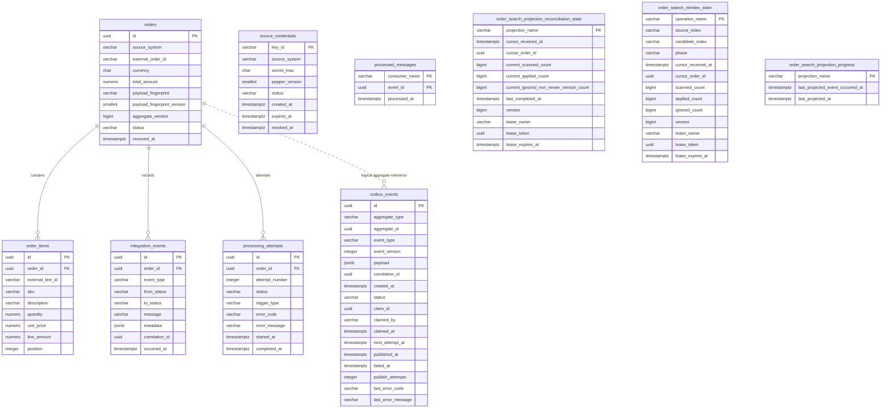
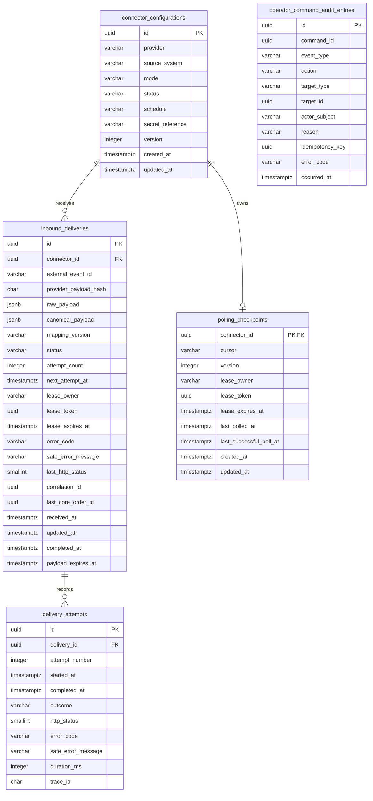

# Relational Data Model

The first diagram describes the PostgreSQL schema owned by the Integration
Core. Flyway migrations remain its authoritative schema definition.

`orders.source_system` and `orders.external_order_id` form one composite unique
key. The two unique constraints on `order_items` combine `order_id` with
`position` and with a non-null `external_line_id`, respectively.

`integration_events.order_id` is a physical foreign key with cascading deletion.
`outbox_events.aggregate_id` is deliberately a logical reference rather than a
foreign key because the outbox is structured to carry events for different
aggregate types. The current schema restricts `aggregate_type` to `ORDER`.
Outbox claim fields are present only while an event is `PUBLISHING`. A terminal
`FAILED` event requires `failed_at`, `last_error_code`, and a safe error message.

`source_credentials` stores a credential identifier, its source identity, a
lowercase HMAC-SHA-256 MAC, and the pepper version needed for verification. Its
constraints keep status, expiry, and revocation timestamps consistent. See
[ADR 0001](decisions/0001-source-api-key-authentication.md) for the authentication
and rotation decision. Order endpoints authenticate against these credentials
and use the resulting source identity to constrain order access.

`processed_messages` is the consumer inbox. Its composite primary key allows
independent consumers to process the same event while rejecting another effect
for the same consumer and event ID. It has no foreign key to `outbox_events`
because consumed events belong to the messaging boundary and may originate from
another service. The table exists before the consumer adapter so its persistence
contract can be implemented and tested independently.

`processing_attempts` records technical executions separately from the business
timeline. Attempt numbers are unique within an order, and a partial unique index
allows at most one `STARTED` attempt per order. State constraints require
successful and failed attempts to have a completion time, while only failed
attempts may contain a non-blank safe error code and message.

`orders.aggregate_version` increases with authoritative state changes and is
included in `OrderReady.v2`. OpenSearch uses it to reject equal or stale
projection writes. The three standalone search tables coordinate repair rather
than owning order data: reconciliation persists a leased keyset cursor and
counts, reindexing persists its fenced phase and candidate-index progress, and
projection progress stores the latest successful event/application timestamps.
The OpenSearch index itself is not part of this relational diagram because it is
a rebuildable read model rather than PostgreSQL state.

## Connector Gateway

The Connector Gateway owns a separate schema managed with Kysely migrations.
It does not read Integration Core tables and shares no transaction with the
core.

`connector_id` and `external_event_id` form the delivery idempotency key. A
second delivery with the same key must be classified atomically as an equivalent
replay or a payload conflict by comparing its SHA-256 fingerprint. Check
constraints bound connector modes, delivery states, hashes, attempts, leases,
and HTTP status values. Active states are `RECEIVED`, `FORWARDING`, and
`RETRY_WAIT`; terminal states are `DELIVERED`, `PERMANENT_FAILURE`,
`BLOCKED_CONFIGURATION`, and `EXHAUSTED`. A lifecycle constraint requires lease
ownership only while forwarding and `completed_at` only for terminal rows. A
partial index orders dispatchable rows by their next attempt and receipt times.

`canonical_payload` is nullable only for an `ERP_B` poison item stored directly
as `PERMANENT_FAILURE` with one of the bounded mapping error codes. All
forwardable states still require a canonical payload, and the claim query also
excludes null payloads explicitly. This allows the polling cursor to advance
past a permanently unmappable item without making it eligible for forwarding.

`polling_checkpoints` has one row per configured polling connector. A null
cursor represents the initial request. Version supports compare-and-swap
updates, while lease owner, token, and expiry are either all absent or all
present with a future expiry. Poll/success timestamps are constrained so a
success cannot occur after the most recent poll. Migration `006` seeds the
synthetic `ERP_B` connector and its initial checkpoint. The page repository
locks this row, verifies its version and unexpired lease, stores every accepted
or rejected item, and advances the cursor in one transaction. A stale owner,
payload conflict, or database failure rolls back the complete page.

The claim adapter locks only eligible delivery rows with `SKIP LOCKED`, assigns
one lease token to a bounded batch, and commits before network work begins. The
owner, token, and expiry are either all null or all present. Completion and
recovery transitions match the token so a late worker cannot mutate a new
ownership generation. See the
[gateway delivery lifecycle](gateway-delivery-lifecycle.md).

The repository uses the composite unique key to classify concurrent first
receipt, equivalent replay, and conflicting content transactionally. It never
replaces the original delivery when a provider reuses an event identity with a
different payload. The signed-webhook route invokes this adapter before
returning `202`; forwarding state is processed separately.

`delivery_attempts` stores bounded technical evidence separately from delivery
state. Attempt numbers are unique per delivery. Database constraints distinguish
an open attempt from a completed one, validate outcome, duration, HTTP status,
and trace ID shape, require delivered attempts to record `200` or `201`, and
prevent successful attempts from carrying error data.
Fenced attempt creation is implemented atomically with the delivery attempt
counter. Successful completion atomically closes the current attempt and moves
the delivery to `DELIVERED`. Retryable completion atomically schedules
`RETRY_WAIT` or terminates as `EXHAUSTED`; permanent and configuration failures
close both records and configuration rejection blocks an active connector.
Polling checkpoint acquisition is implemented as a conditional update that
accepts only an active polling connector with no lease or an expired lease. It
replaces expired ownership with a new fencing token without changing the cursor
version. Renewal requires the current owner/token and an unexpired lease, never
shortens its expiry, and stops when the connector is disabled. Clean release
also requires the current owner/token but may clear an expired lease that has
not been reacquired. These operations do not change cursor version. The bounded
provider runner, non-overlapping scheduler, and disabled-by-default runtime
composition in `main.ts` are implemented.

`operator_command_audit_entries` is the append-only journal used by privileged
Gateway commands. The current delivery replay records the operator subject,
target, rationale, idempotency key, timestamp, and outcome without relying on
mutable command state. PostgreSQL rejects updates and deletes through a trigger.
A partial unique index permits one `REQUESTED` record for an
operator/idempotency-key pair and one terminal outcome per command. Audit
reservation, delivery transition, and terminal outcome share one transaction.
