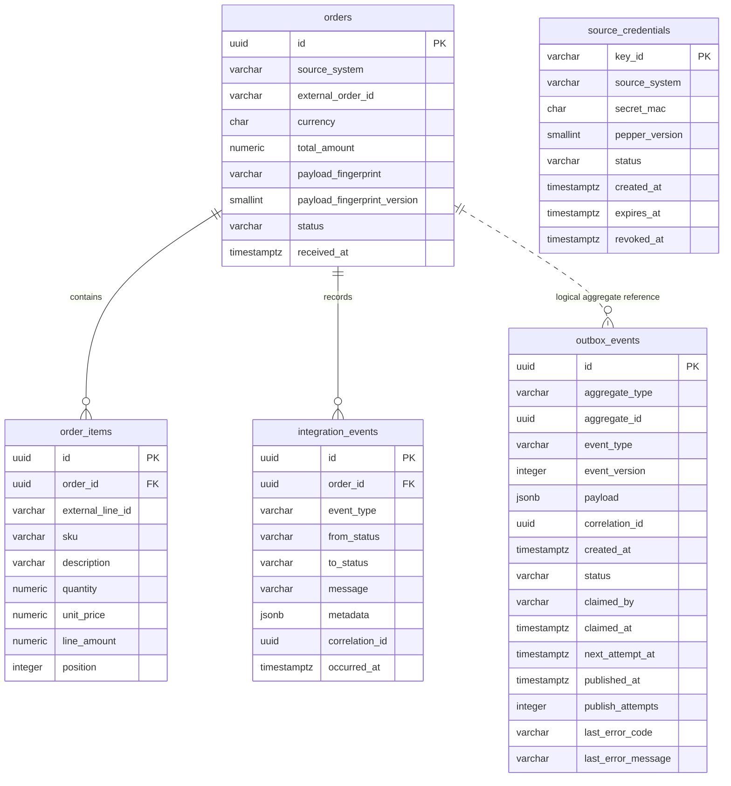

# Relational Data Model

This diagram describes the PostgreSQL schema currently implemented by the
Integration Core. Flyway migrations remain the authoritative schema definition.

`orders.source_system` and `orders.external_order_id` form one composite unique
key. The two unique constraints on `order_items` combine `order_id` with
`position` and with a non-null `external_line_id`, respectively.

`integration_events.order_id` is a physical foreign key with cascading deletion.
`outbox_events.aggregate_id` is deliberately a logical reference rather than a
foreign key because the outbox is structured to carry events for different
aggregate types. The current schema restricts `aggregate_type` to `ORDER`.

`source_credentials` stores an HMAC of each secret, never the plaintext API key.
Its `source_system` value will become the authenticated source identity when the
HTTP authentication increment is connected.
