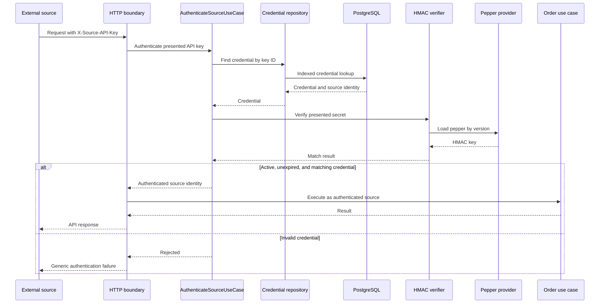

# ADR 0001: Authenticate Sources with Structured API Keys

- Status: Accepted
- Date: 2026-08-14

## Context

The ingestion API identifies external source systems in machine-to-machine
requests. It needs efficient lookup, source isolation, revocation, expiry, and
credential rotation without introducing an identity provider into the first
release.

This decision covers source-system authentication only. Login, user management,
token issuance, and operator authorization are outside its scope.

## Decision

Sources present `X-Source-API-Key: <key_id>.<secret>`:

- `key_id` is a non-secret indexed lookup handle;
- `key_id` and the 32-byte secret are generated with a cryptographically secure
  random number generator;
- `secret` is encoded as 43 characters of unpadded Base64URL and disclosed only
  during provisioning;
- PostgreSQL stores the source identity and HMAC-SHA-256 of the secret, never the
  plaintext secret;
- HMAC uses the versioned deployment pepper as its key and the exact presented
  secret as its message;
- each pepper contains at least 32 random bytes and is supplied outside
  PostgreSQL and source control;
- MACs are compared in constant time before checking active and expiry state;
- the authenticated source identity comes from the credential row, not request
  content;
- malformed, unknown, expired, revoked, and incorrect credentials produce the
  same authentication rejection.

Constant-time behavior applies to the fixed-length MAC comparison. An unknown
key ID terminates after its indexed lookup and is not guaranteed to have the same
latency as a known key. This is accepted because key IDs are non-secret,
high-entropy handles; the HTTP boundary must still return a generic response and
apply rate limiting.

Rotation creates another credential row. The previous row may remain active for
a bounded transition and is then revoked. A referenced pepper version that is
not configured is an operational error rather than an authentication rejection.

Operator endpoints will use externally issued JWTs because they require user
identity and roles. OAuth 2.0 Client Credentials remains a possible production
evolution for source authentication.

## Authentication Flow

The credential lookup, pepper resolution, HMAC verification, and application
authentication shown above are implemented. The HTTP boundary and its call to
the order use case describe the next implementation increment.

## Alternatives

- **Plaintext secrets:** rejected because a database disclosure would expose
  immediately usable credentials.
- **Unkeyed SHA-256:** rejected in favor of a versioned deployment pepper, which
  keeps the verification key outside the database.
- **Argon2 or bcrypt:** intended for low-entropy human passwords. These source
  secrets have 256 bits of random entropy, so their per-request cost adds limited
  security value and increases denial-of-service exposure.
- **JWT or OAuth 2.0 immediately:** deferred because the first source boundary
  does not need claims, delegation, or token issuance infrastructure.

## Consequences

Authentication requires one indexed database lookup and one HMAC operation.
Credential provisioning can reveal the secret only once. Deployments must
manage, rotate, and retain required pepper versions securely. API keys remain
bearer credentials, so TLS, header redaction, bounded failure telemetry, and
rate limiting are required at the HTTP boundary.

A database disclosure alone does not expose immediately usable secrets because
the pepper is stored separately. Disclosure of both credential rows and their
pepper requires rotation of every affected credential. Production API keys and
deployment pepper material must not appear in logs, fixtures, telemetry, or
repository configuration.

The credential schema, jOOQ lookup adapter, versioned pepper configuration, CDI
composition, and application verification are implemented. HTTP enforcement,
source-owned read authorization, and administrative provisioning are separate
increments.
