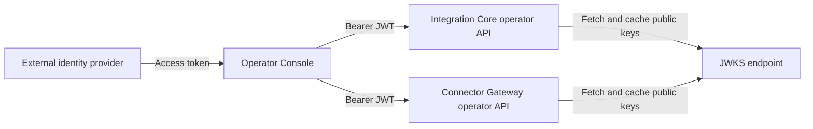

# ADR 0019: Protect Operator APIs With Externally Issued JWTs

- Status: Accepted
- Date: 2026-09-11

## Context

The Integration Core exposes read-only operator endpoints, and the Gateway
exposes delivery inspection plus a controlled replay endpoint. Recovery
operations trigger controlled mutations, so network placement alone is not an
adequate trust boundary.

The project already has two unrelated machine-authentication mechanisms:
source API keys protect canonical order ingestion, and provider HMAC signatures
protect `MARKETPLACE_A` webhooks. Reusing either mechanism for human operators
would mix identities, permissions, rotation policies, and audit semantics.

The portfolio does not need to implement registration, passwords, login,
refresh tokens, or an identity provider. It does need to demonstrate correct
resource-server behavior that can integrate with a real OpenID Connect issuer.

## Decision

Treat Integration Core and Connector Gateway operator APIs as OAuth 2.0
resource servers. They accept bearer access tokens issued by an external
identity provider and validate them independently against configurable issuer,
audience, and JWKS settings.

The initial security profile is:

- asymmetric `RS256` signatures only, selected through the token `kid` and a
  remotely supplied JWKS;
- exact issuer and audience validation;
- mandatory, canonical `sub` identity;
- mandatory expiry validation and validation of `nbf` when present;
- a small configurable clock-skew allowance;
- roles read from a bounded `groups` string-array claim;
- `operator` for read-only order, search, delivery, failure, and progress
  inspection;
- `platform-admin` for controlled recovery commands in addition to read access.

`platform-admin` includes operator read permissions in application policy. The
services must not depend on an identity-provider-specific role hierarchy.

Missing, malformed, expired, not-yet-valid, incorrectly signed, wrong-issuer,
wrong-audience, or unsupported-algorithm tokens return `401 Unauthorized` with
a bearer challenge. A valid identity without the required role returns
`403 Forbidden`. Responses and logs must not expose bearer tokens, signature
material, unbounded claims, or detailed cryptographic failure reasons.

The existing source API-key and webhook HMAC boundaries remain unchanged.
Operator authorization is applied only to `/api/v1/operator/**` in the Core and
Gateway. Health, readiness, metrics, OpenAPI, and provider routes retain their
separately documented deployment controls.

Local integration tests use a test-only RSA key pair, a controlled JWKS server,
and short-lived tokens. Production configuration supplies the issuer, audience,
and JWKS location through environment-specific settings. No private signing key
is included in a production artifact or committed fixture.

## Alternatives

- **Reuse source API keys:** rejected because source credentials identify
  systems, not people, and cannot express operator permissions or audit subject.
- **Use symmetric JWT signatures:** rejected because every validating service
  would also hold token-signing material.
- **Build login and token issuance:** rejected because identity lifecycle is a
  separate product and would distract from resource-server correctness.
- **Protect only mutation endpoints:** rejected because operational reads expose
  cross-source business and failure data.
- **Accept several JWT algorithms initially:** rejected because a narrow
  allowlist reduces configuration mistakes; another asymmetric algorithm can be
  added through a later decision when an issuer requires it.

## Consequences

Integration Core will use Quarkus OIDC bearer-token validation, while Connector
Gateway will use a maintained JOSE implementation behind its Fastify
authentication boundary. Both implementations must share contract tests for
claim semantics and authorization outcomes even though their framework adapters
differ.

The OpenAPI documents need a bearer security scheme and per-operation role
descriptions. The Operator Console accepts an externally obtained token in page
memory only; this ADR does not select an identity provider or login flow.
Recovery audit records can use the validated `sub` as the immutable actor
identifier without persisting the complete token or claim set.
