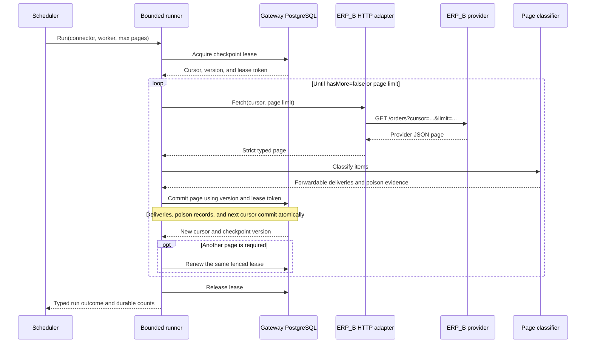
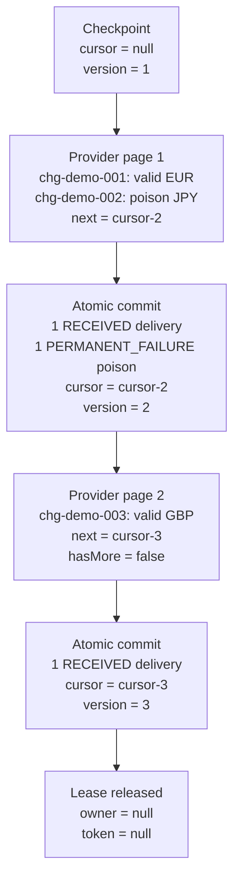
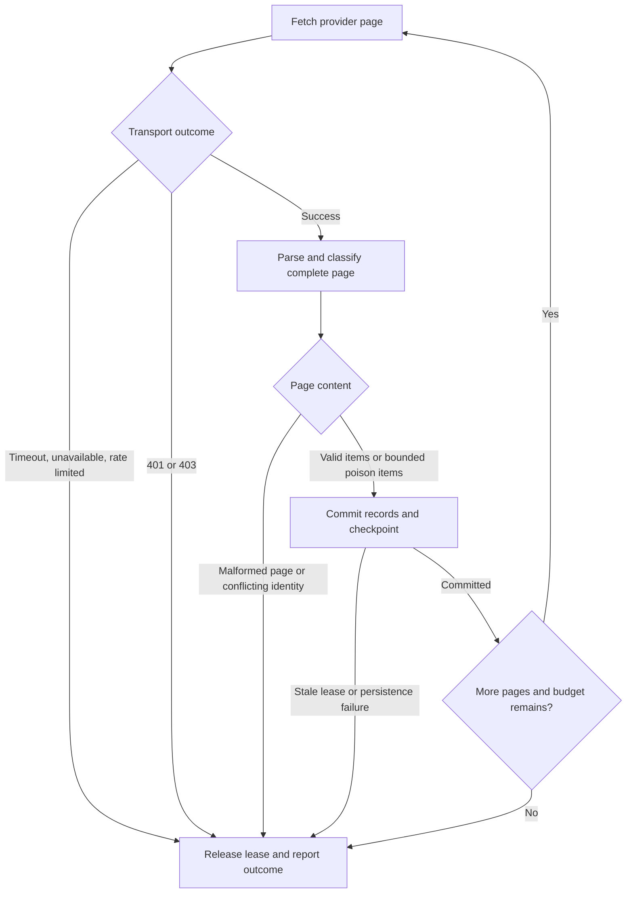

# ERP_B Polling

This document shows how the Connector Gateway imports cursor-paginated changes
from `ERP_B`. The provider simulator supplies deterministic external behavior;
all mapping, reliability, and persistence rules remain owned by the Gateway.

## Responsibilities

```mermaid
flowchart LR
    Scheduler[Polling scheduler]
    Runner[Bounded polling runner]
    Client[ERP_B HTTP adapter]
    Provider[ERP_B provider or simulator]
    Classifier[Page parser, mapper, and classifier]
    Repository[Polling page repository]
    Database[(Gateway PostgreSQL)]
    Forwarder[Delivery worker]
    Core[Integration Core]

    Scheduler -->|Start one non-overlapping run| Runner
    Runner -->|Acquire, renew, and release lease| Repository
    Runner -->|Fetch cursor page| Client
    Client -->|Bearer-authenticated HTTP request| Provider
    Provider -->|Provider page| Client
    Client -->|Strict typed page| Classifier
    Classifier -->|Deliveries and poison records| Repository
    Repository -->|Atomic page and checkpoint commit| Database
    Database -->|Due forwardable deliveries| Forwarder
    Forwarder -->|Canonical order HTTP request| Core
```

The runner coordinates the workflow but does not interpret provider payloads or
write SQL. The HTTP adapter owns transport policy, the classifier owns provider
semantics, and the repository owns transactional durability and fencing.

## One Polling Run

If a page cannot be fetched, parsed, classified, or committed, its checkpoint
does not advance. Pages committed earlier in the same bounded run remain
durable. The lease is released in every ordinary completion path.

## Durable Progress

With a page limit of two, the deterministic simulator demonstrates this state
change:

The cursor and version are durable progress, not in-memory loop variables. A
new process or another replica resumes from the last committed cursor. The
owner and random lease token fence stale workers, so only the current lease
holder may advance that checkpoint.

## Failure Boundaries

An unsupported item such as the simulator's JPY order is durable poison
evidence, so it does not block the rest of a valid page. A malformed page or two
different payloads using the same provider change ID is ambiguous at page level
and therefore prevents the checkpoint from advancing.

Persisting connector `BLOCKED_CONFIGURATION` after an `ERP_B` `401` or `403`
is the next planned reliability increment. The current typed outcome stops the
run, but does not yet disable later scheduled attempts.

## Related Documentation

- [Gateway delivery lifecycle](gateway-delivery-lifecycle.md) describes the
  delivery claim, forwarding, retry, and recovery state machines.
- [Relational data model](data-model.md) shows delivery and polling tables.
- [Provider simulator](../tools/provider-simulator/README.md) documents the
  local deterministic provider boundary.
