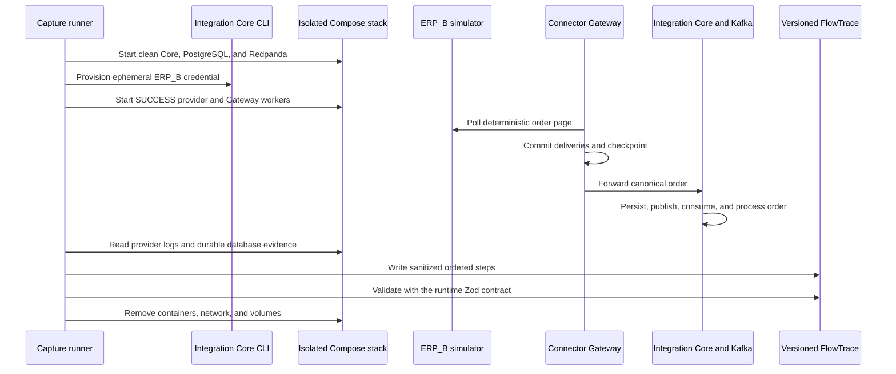

# Integration Flow Explorer

The Flow Explorer replays sanitized evidence captured from deterministic local
Compose scenarios. React does not fabricate service activity and production
services expose no demo-control endpoints.

## Capture Boundary



The success trace derives its HTTP timing from structured simulator logs,
Gateway delivery and attempt state from Gateway PostgreSQL, and order, outbox,
timeline, and processing state from Core PostgreSQL. The poison-item trace
combines the same HTTP evidence with the durable rejection and checkpoint state
from Gateway PostgreSQL; it also verifies that no delivery attempt or Core order
exists. The authentication-rejection trace combines the observed provider `401`
with the blocked connector version and released polling lease; it verifies that
no delivery or Core order exists. Equal-millisecond events use a stable causal
priority; elapsed time otherwise comes from recorded timestamps.

## Generate The Traces

Docker, Java 25, Maven, pnpm, curl, jq, and sed must be available. From the
repository root run:

```bash
./scripts/capture-v0.7-erp-b-success.sh
./scripts/capture-v0.7-erp-b-poison-item.sh
./scripts/capture-v0.7-erp-b-authentication-rejection.sh
```

Each runner writes its matching artifact below
`apps/operator-console/public/flow-traces/v1`, validates every captured artifact,
and removes its isolated Compose resources. Set `KEEP_FLOW_TRACE_STACK=true`
only while diagnosing a failed local capture.

## Playback Time

The player retains each recorded `offsetMs` for inspection but uses a separate
presentation timeline. Every transition is clamped between 600 and 1,600 ms so
that millisecond failure paths remain visible and long operational waits do not
stall the demonstration. A pure state transition function owns play, pause,
restart, elapsed-time advancement, completion, and manual step selection; React
only schedules animation frames and renders the resulting state. The system
`prefers-reduced-motion` setting suppresses autoplay while preserving manual
step selection and playback controls.

## Console Replay

Start the Operator Console with `pnpm dev` from `apps/operator-console`, then
open `/flow-explorer`. The route is lazy-loaded so its player and runtime
validation code do not enlarge the initial Orders or Simulator bundle.

The page reads only the committed artifacts below
`apps/operator-console/public/flow-traces/v1`. Scenario selection loads a new
trace and resets playback; the participant stage, keyboard-operable timeline,
controls, and evidence panel render the same active step. Loading and retry
states cover unavailable artifacts. The console supports English and Italian.

Run `pnpm test:e2e` from `apps/operator-console` to exercise the actual browser
route with reduced motion, scenario selection, timeline keyboard navigation,
recorded rejection evidence, and a 320 px overflow check. Browser-level tests
remain local by design and are not part of GitHub Actions.

## Contract And Sanitization

`FlowTrace` schema version `1.0` accepts a closed set of scenario IDs,
participant kinds, event phases, statuses, and evidence fact names. It also
enforces unique references, contiguous sequence numbers, monotonic offsets,
bounded text, and a terminal step consistent with the scenario outcome.

The artifact contains no request body, response body, header, credential,
database connection value, error text, or internal row identifier. Correlation
identity is retained because it is non-secret diagnostic evidence. The source
credential exists only in the runner process and the disposable Core database.

## Limitations

The artifact is a reproducible portfolio and learning surface, not an audit log,
distributed trace, monitoring backend, or proof of production latency. Capture
currently supports the ERP_B success, poison-item, and authentication-rejection
scenarios. The accessible visual player is delivered within `v0.7.0`.
