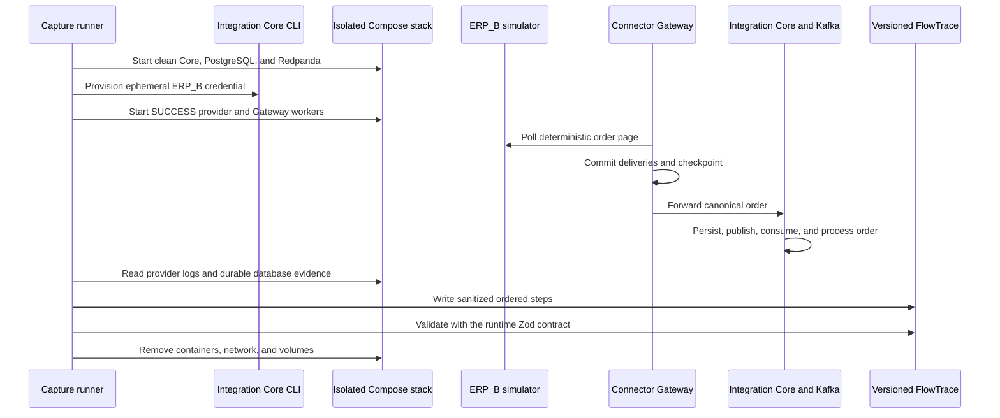

# Integration Flow Explorer

The Flow Explorer replays sanitized evidence captured from deterministic local
Compose scenarios. React does not fabricate service activity and production
services expose no demo-control endpoints.

## Capture Boundary



The success trace derives its HTTP timing from structured simulator logs,
Gateway delivery and attempt state from Gateway PostgreSQL, and order, outbox,
timeline, and processing state from Core PostgreSQL. Equal-millisecond events
use a stable causal priority; elapsed time otherwise comes from recorded
timestamps.

## Generate The Success Trace

Docker, Java 25, Maven, pnpm, curl, jq, and sed must be available. From the
repository root run:

```bash
./scripts/capture-v0.7-erp-b-success.sh
```

The runner writes
`apps/operator-console/public/flow-traces/v1/erp-b-success.json`, validates it,
and removes its isolated Compose resources. Set `KEEP_FLOW_TRACE_STACK=true`
only while diagnosing a failed local capture.

## Contract And Sanitization

`FlowTrace` schema version `1.0` accepts a closed set of scenario IDs,
participant kinds, event phases, statuses, and evidence fact names. It also
enforces unique references, contiguous sequence numbers, monotonic offsets,
bounded text, and a terminal step consistent with the scenario outcome.

The artifact contains no request body, response body, header, credential,
database connection value, error text, or internal row identifier. Correlation
identity is retained because it is non-secret diagnostic evidence. The source
credential exists only in the runner process and the disposable Core database.

## Limitations

The artifact is a reproducible portfolio and learning surface, not an audit log,
distributed trace, monitoring backend, or proof of production latency. Capture
currently supports only the ERP_B success scenario. Poison-item and
authentication-rejection capture remain part of `v0.7.0`.
