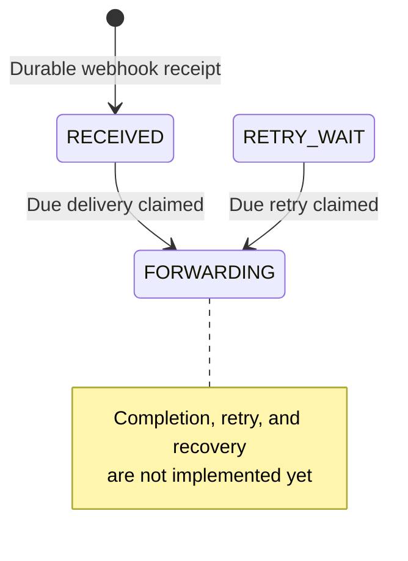
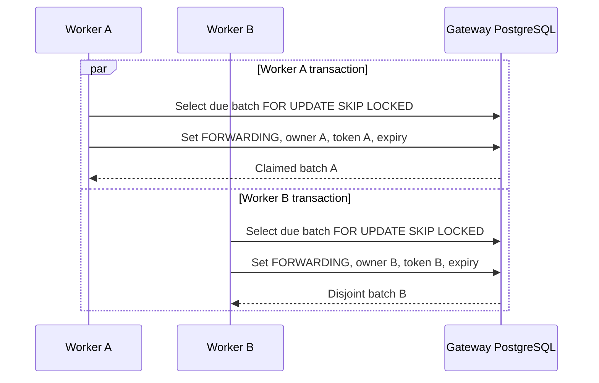

# Gateway Delivery Claim Lifecycle

This document describes the implemented claim boundary. HTTP forwarding,
completion, retry scheduling, and expired-lease recovery remain later slices.

## Current State Transition

Only deliveries belonging to an `ACTIVE` connector are eligible. Claims are
ordered by `next_attempt_at`, then `received_at`, and bounded to 100 rows. The
configured lease duration is bounded to five minutes.

## Concurrent Claim

The transaction commits before any future Integration Core HTTP call. Every
later state transition must match delivery ID, worker ID, and lease token. A
claim does not increment `attempt_count` because no network attempt has started
at that point.

See [ADR 0012](decisions/0012-short-lived-gateway-delivery-claims.md) for the
decision and rejected alternatives.
