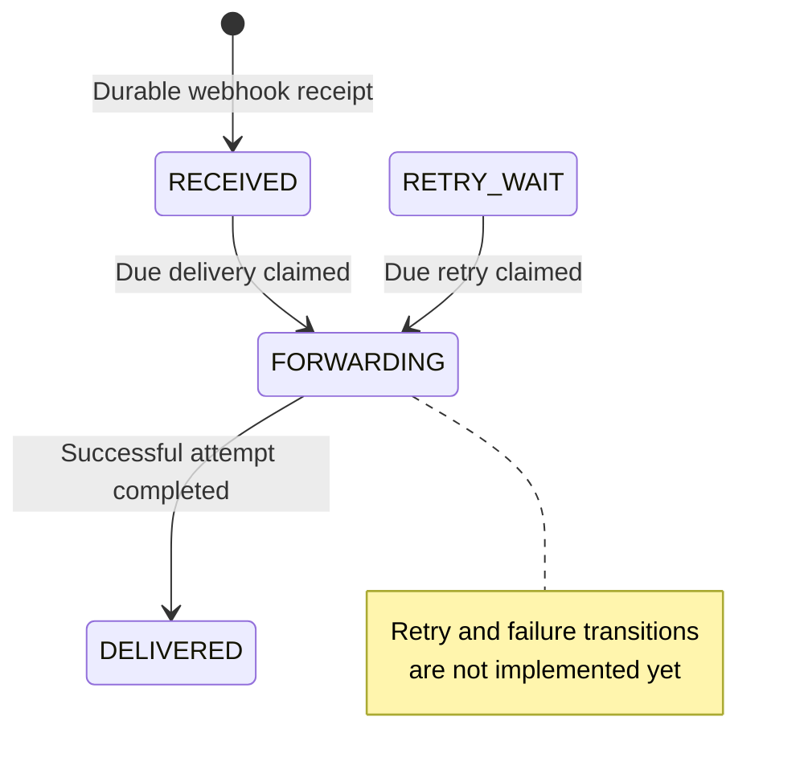
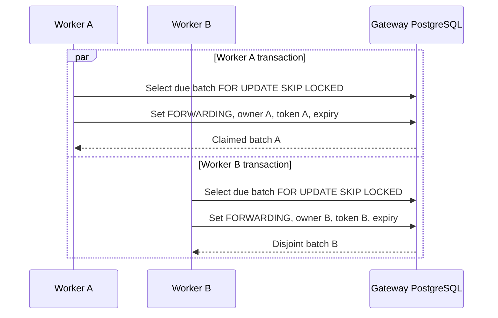

# Gateway Delivery Claim Lifecycle

This document describes the implemented claim boundary. The Integration Core
HTTP adapter is implemented and tested independently; worker composition,
remaining completion outcomes, retry scheduling, and expired-lease recovery
remain later slices.

## Current State Transition

Only deliveries belonging to an `ACTIVE` connector are eligible. Claims are
ordered by `next_attempt_at`, then `received_at`, and bounded to 100 rows. The
configured lease duration is bounded to five minutes.

The persisted terminal vocabulary is `DELIVERED`, `PERMANENT_FAILURE`,
`BLOCKED_CONFIGURATION`, and `EXHAUSTED`. These states require a completion
timestamp and no lease. `DELIVERED` completion is implemented; the remaining
terminal transitions are not.

## Concurrent Claim

The transaction commits before the Integration Core HTTP call. Every
later state transition must match delivery ID, worker ID, and lease token. A
claim does not increment `attempt_count` because no network attempt has started
at that point.

The `delivery_attempts` table now defines the evidence written when a real call
starts and completes. The fenced start operation atomically verifies the current
unexpired claim, increments `attempt_count`, and inserts the open attempt. A
stale worker changes nothing. Successful completion atomically closes the
current attempt, records duration,
HTTP status and core order ID, clears the lease, and moves the delivery to
`DELIVERED`. A mismatched claim changes nothing, while missing current attempt
evidence rolls back the whole completion transaction.

The HTTP adapter maps Integration Core responses to delivered, blocked
configuration, permanent failure, or retryable failure. It does not update the
ledger. This keeps network policy separate from fenced state transitions and
allows a late worker result to be rejected safely.

See [ADR 0012](decisions/0012-short-lived-gateway-delivery-claims.md) for the
claim decision and [ADR 0013](decisions/0013-classify-integration-core-http-outcomes.md)
for HTTP outcome classification.
