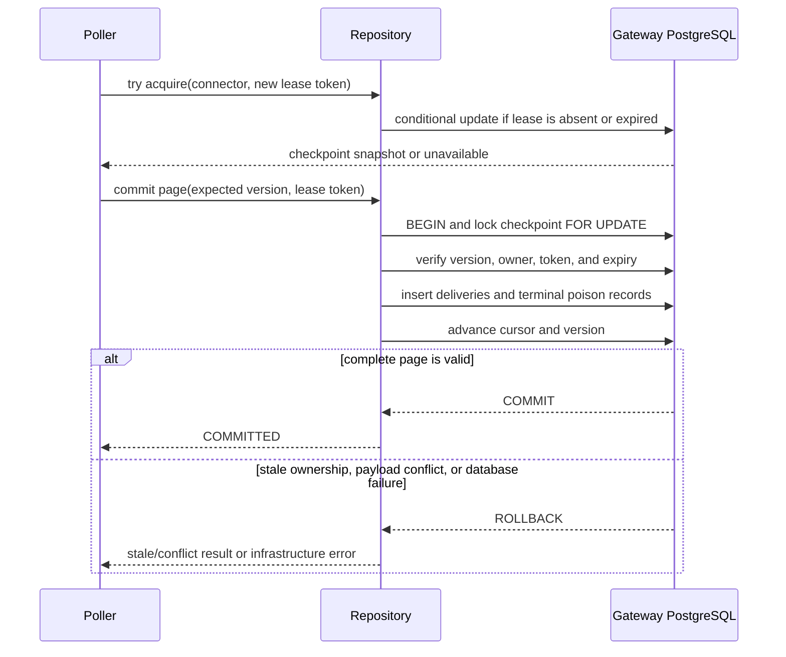
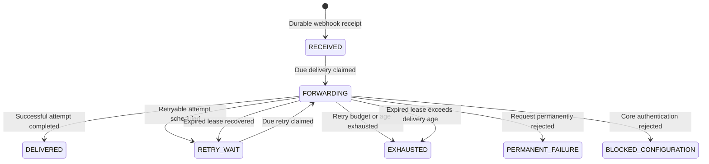
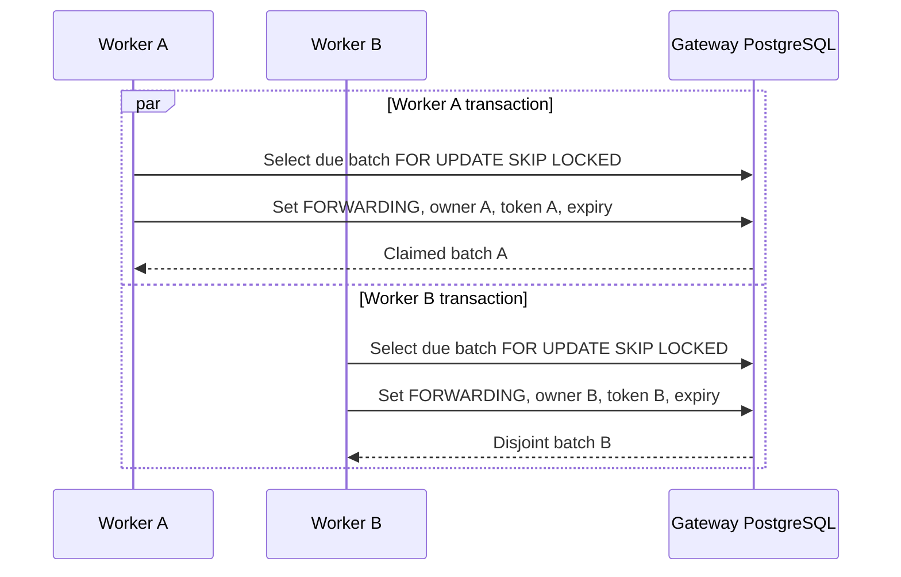
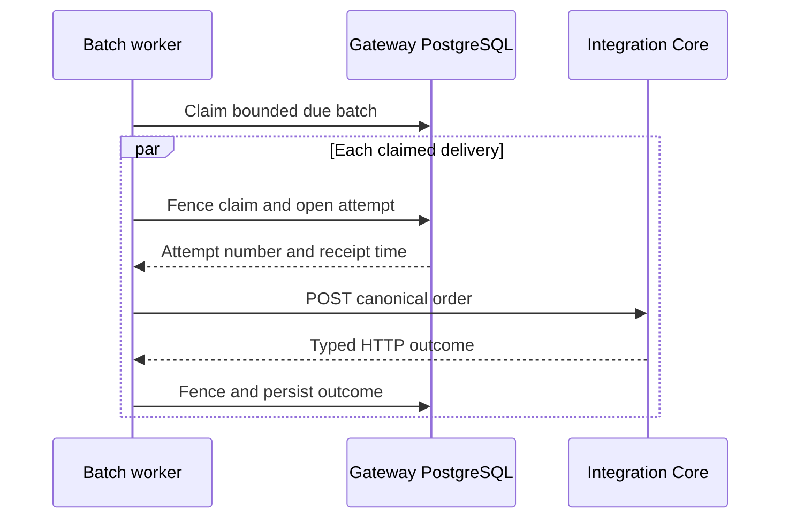
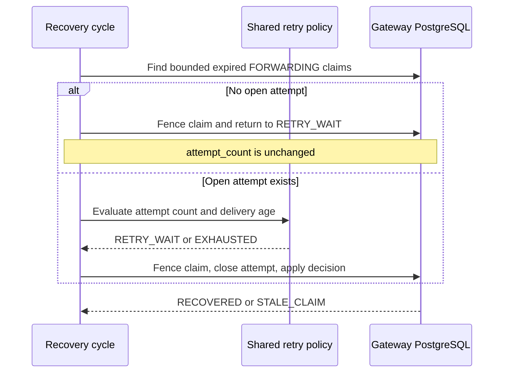

# Gateway Delivery Claim Lifecycle

This document describes the implemented claim, attempt, completion, and recovery
boundaries. The Integration Core HTTP adapter, application batch worker, and
non-overlapping runtime scheduler are implemented and tested.

## Provider Delivery Identity

`MARKETPLACE_A` identifies a delivery by its provider event ID and fingerprints
the exact signed webhook bytes. Byte-level differences therefore remain visible
even when two JSON documents would parse to equivalent values.

`ERP_B` extracts individual changes from a polled page, so no independently
signed raw body exists for one delivery. Its receipt command reconstructs a
fixed-key JSON representation containing every validated provider field and
canonicalization version `erp-b-provider-item-v1`, then computes SHA-256 over
that representation. Object property insertion order cannot change the result;
position order remains significant because it is part of the mapped order.
Mapping version and provider-item canonicalization version are separate
compatibility boundaries. The atomic page/checkpoint repository is implemented;
the provider HTTP client and scheduled polling loop remain planned.

The implemented pure page classifier converts mappable changes into ordinary
inbound-delivery commands and mapping failures into bounded permanent-rejection
records with stable `ERP_B_*` error codes. Equivalent duplicate change IDs in
one page collapse to one record. A duplicate ID with a different item
fingerprint rejects the entire page, preventing a later checkpoint transaction
from advancing across ambiguous provider evidence.

Migration `006` adds the seeded `ERP_B` polling checkpoint and permits a null
canonical payload only for a terminal poison item carrying one of the bounded
mapping error codes. The forwarding claim query excludes null canonical
payloads explicitly. Atomic persistence of a classified page and checkpoint is
implemented and PostgreSQL integration-tested.

## Polled Page Commit

Equivalent replays do not create duplicate delivery rows but still allow the
page cursor to advance. A reused provider identity with a different fingerprint
rolls back earlier inserts from that page. Concurrent commits for the same
checkpoint version serialize on the row lock; exactly one advances the version.
Lease acquisition similarly uses one conditional update, so concurrent workers
cannot both own an available checkpoint. Reclaiming an expired lease installs a
new token that fences the previous worker without changing the cursor version.

## Current State Transition

Only deliveries belonging to an `ACTIVE` connector are eligible. Claims are
ordered by `next_attempt_at`, then `received_at`, and bounded to 100 rows. The
configured lease duration is bounded to five minutes.

The persisted terminal vocabulary is `DELIVERED`, `PERMANENT_FAILURE`,
`BLOCKED_CONFIGURATION`, and `EXHAUSTED`. These states require a completion
timestamp and no lease. All transitions shown above are implemented and tested
at repository and application-orchestration boundaries.

## Concurrent Claim

The transaction commits before the Integration Core HTTP call. Every
later state transition must match delivery ID, worker ID, and lease token. A
claim does not increment `attempt_count` because no network attempt has started
at that point.

## Processing Batch

The application worker executes the claimed batch concurrently. The claim batch
size therefore also bounds HTTP concurrency. A stale attempt start is never
forwarded, and a stale completion is counted separately from the remote outcome.
Unexpected infrastructure failure is propagated; its claim remains
`FORWARDING` for the expired-lease recovery cycle.

The runtime executes recovery before processing, waits for a cycle to finish
before scheduling the next one, and logs only cycles with activity or unexpected
failure. Shutdown aborts in-flight HTTP work, waits for the active cycle, and
then closes PostgreSQL. The worker is explicitly enabled through configuration;
receipt-only operation remains available.

Scheduling runs inside the long-lived Node.js process using a one-shot timer
created only after the preceding cycle completes. It is not an external cron or
Kubernetes `CronJob`. Multiple service replicas can run the scheduler because
database row locks, leases, and fencing tokens coordinate delivery ownership.
The process-level integration test exercises this runtime from a signed webhook
through a real PostgreSQL ledger and local HTTP core to `DELIVERED`, then verifies
graceful `SIGTERM` shutdown and absence of configured secrets from captured logs.

Prometheus records cycle outcomes and duration, active-cycle state, last
successful cycle time, fixed delivery outcomes, and recovery outcomes. Labels
are bounded enums; delivery and worker identities remain in logs and the ledger,
not metric labels.

The `delivery_attempts` table now defines the evidence written when a real call
starts and completes. The fenced start operation atomically verifies the current
unexpired claim, increments `attempt_count`, and inserts the open attempt. A
stale worker changes nothing. Successful completion atomically closes the
current attempt, records duration,
HTTP status and core order ID, clears the lease, and moves the delivery to
`DELIVERED`. A mismatched claim changes nothing, while missing current attempt
evidence rolls back the whole completion transaction.

## Expired Lease Recovery

Retryable completion uses at most five actual attempts and a 24-hour delivery
age. Equal jitter is applied to base delays of 5 seconds, 30 seconds, 2 minutes,
and 10 minutes. A bounded `Retry-After` may extend but never shorten that delay.
Retry schedules `next_attempt_at`; exhausted work receives a terminal completion
timestamp. Both paths close the attempt and clear the lease atomically.

Permanent failure and blocked configuration also close the current attempt and
delivery atomically. A core `401` or `403` moves an active connector to
`BLOCKED_CONFIGURATION`, preventing further claims. A connector already marked
`DISABLED` is never overwritten by this automatic transition.

Expired leases are scanned in bounded oldest-first batches. Recovery before an
HTTP attempt returns the delivery to `RETRY_WAIT` immediately without changing
`attempt_count`. Recovery with an open attempt closes that attempt as
`RETRYABLE_FAILURE` and applies the same bounded retry policy as an ordinary
transport failure. The recovery update matches the observed owner, token,
attempt number, and expiry; a changed claim returns `STALE_CLAIM`, while changed
attempt evidence rolls back the transaction for reevaluation on a later scan.

The HTTP adapter maps Integration Core responses to delivered, blocked
configuration, permanent failure, or retryable failure. It does not update the
ledger. This keeps network policy separate from fenced state transitions and
allows a late worker result to be rejected safely.

See [ADR 0012](decisions/0012-short-lived-gateway-delivery-claims.md) for the
claim decision and [ADR 0013](decisions/0013-classify-integration-core-http-outcomes.md)
for HTTP outcome classification. [ADR 0014](decisions/0014-bound-gateway-delivery-retries.md)
records the retry policy.
