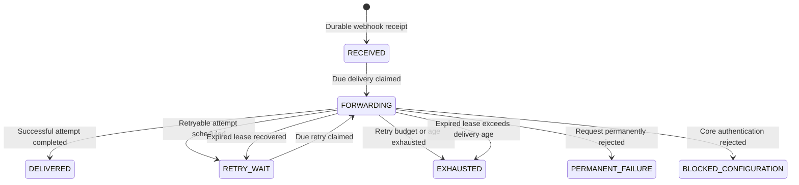
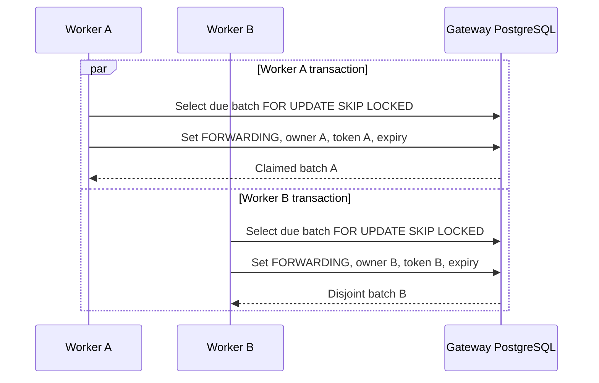
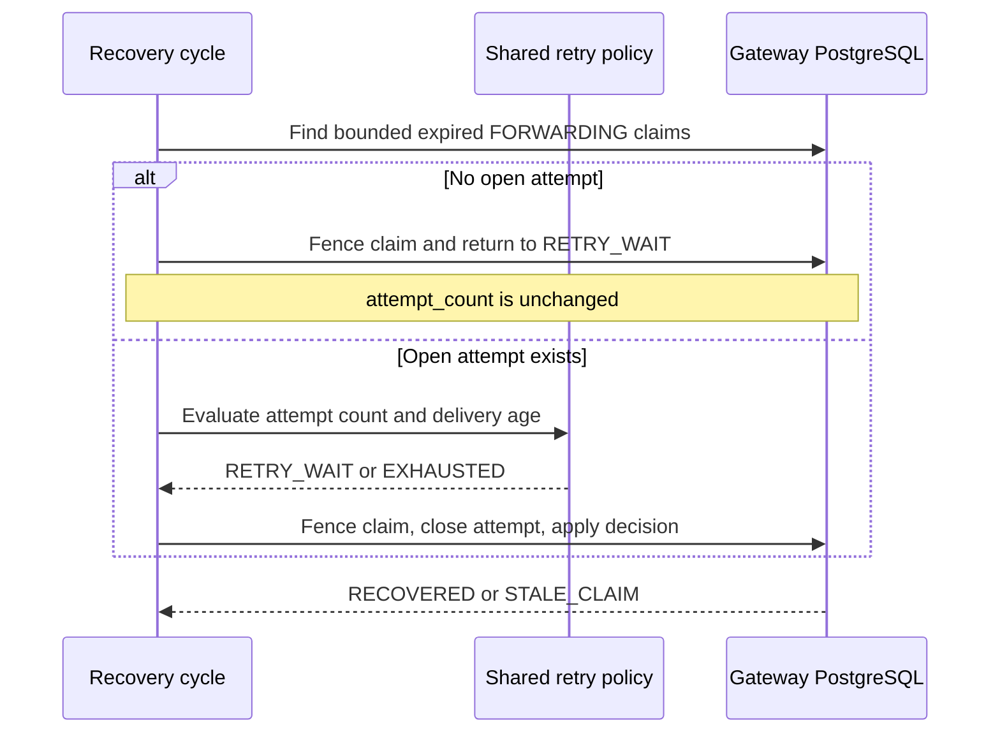

# Gateway Delivery Claim Lifecycle

This document describes the implemented claim, attempt, completion, and recovery
boundaries. The Integration Core HTTP adapter is implemented and tested
independently; scheduled worker composition remains a later slice.

## Current State Transition

Only deliveries belonging to an `ACTIVE` connector are eligible. Claims are
ordered by `next_attempt_at`, then `received_at`, and bounded to 100 rows. The
configured lease duration is bounded to five minutes.

The persisted terminal vocabulary is `DELIVERED`, `PERMANENT_FAILURE`,
`BLOCKED_CONFIGURATION`, and `EXHAUSTED`. These states require a completion
timestamp and no lease. All transitions shown above are implemented and tested
independently of worker composition.

## Concurrent Claim

The transaction commits before the Integration Core HTTP call. Every
later state transition must match delivery ID, worker ID, and lease token. A
claim does not increment `attempt_count` because no network attempt has started
at that point.

The `delivery_attempts` table now defines the evidence written when a real call
starts and completes. The fenced start operation atomically verifies the current
unexpired claim, increments `attempt_count`, and inserts the open attempt. A
stale worker changes nothing. Successful completion atomically closes the
current attempt, records duration,
HTTP status and core order ID, clears the lease, and moves the delivery to
`DELIVERED`. A mismatched claim changes nothing, while missing current attempt
evidence rolls back the whole completion transaction.

## Expired Lease Recovery

Retryable completion uses at most five actual attempts and a 24-hour delivery
age. Equal jitter is applied to base delays of 5 seconds, 30 seconds, 2 minutes,
and 10 minutes. A bounded `Retry-After` may extend but never shorten that delay.
Retry schedules `next_attempt_at`; exhausted work receives a terminal completion
timestamp. Both paths close the attempt and clear the lease atomically.

Permanent failure and blocked configuration also close the current attempt and
delivery atomically. A core `401` or `403` moves an active connector to
`BLOCKED_CONFIGURATION`, preventing further claims. A connector already marked
`DISABLED` is never overwritten by this automatic transition.

Expired leases are scanned in bounded oldest-first batches. Recovery before an
HTTP attempt returns the delivery to `RETRY_WAIT` immediately without changing
`attempt_count`. Recovery with an open attempt closes that attempt as
`RETRYABLE_FAILURE` and applies the same bounded retry policy as an ordinary
transport failure. The recovery update matches the observed owner, token,
attempt number, and expiry; a changed claim returns `STALE_CLAIM`, while changed
attempt evidence rolls back the transaction for reevaluation on a later scan.

The HTTP adapter maps Integration Core responses to delivered, blocked
configuration, permanent failure, or retryable failure. It does not update the
ledger. This keeps network policy separate from fenced state transitions and
allows a late worker result to be rejected safely.

See [ADR 0012](decisions/0012-short-lived-gateway-delivery-claims.md) for the
claim decision and [ADR 0013](decisions/0013-classify-integration-core-http-outcomes.md)
for HTTP outcome classification. [ADR 0014](decisions/0014-bound-gateway-delivery-retries.md)
records the retry policy.
