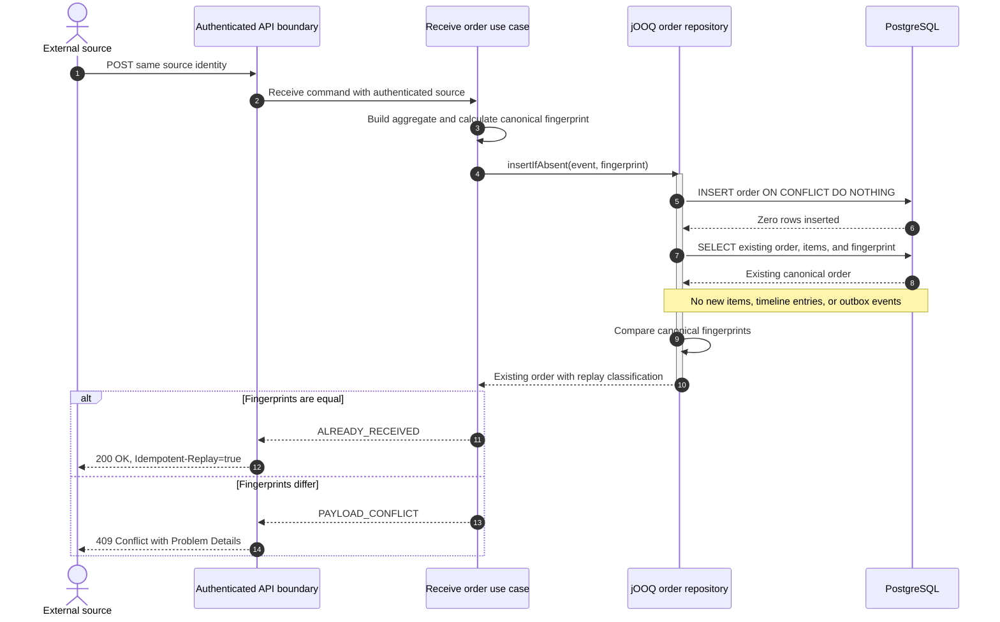

# Order Ingestion Sequences

These diagrams describe the behavior implemented by Integration Core. The
authentication boundary includes the HTTP filter, authentication use case,
credential repository, and constant-time HMAC verification.

## First ingestion

```mermaid
sequenceDiagram
    autonumber
    actor Source as External source
    participant Correlation as Correlation filter
    participant Authentication as Authentication boundary
    participant Resource as Order resource
    participant UseCase as Receive order use case
    participant Repository as jOOQ order repository
    participant Database as PostgreSQL

    Source->>Correlation: POST /api/v1/orders with API key and payload
    Correlation->>Correlation: Preserve or generate correlation ID
    Correlation->>Authentication: Continue request
    Authentication->>Database: Load credential by indexed key ID
    Database-->>Authentication: Active credential and source identity
    Authentication->>Authentication: Verify secret HMAC in constant time
    Authentication->>Resource: SecurityContext with source identity
    Resource->>UseCase: Receive validated transport command
    UseCase->>UseCase: Build aggregate and calculate canonical fingerprint
    UseCase->>Repository: insertIfAbsent(event, fingerprint)
    activate Repository
    Repository->>Database: INSERT order ON CONFLICT DO NOTHING
    Database-->>Repository: One row inserted
    Repository->>Database: Batch INSERT order items
    Repository->>Database: INSERT ORDER_RECEIVED timeline entry
    Repository->>Database: INSERT pending OrderReceived outbox event
    Note over Repository,Database: One transaction; any failed write rolls back all writes
    Repository-->>UseCase: INSERTED with canonical order
    deactivate Repository
    UseCase-->>Resource: CREATED
    Resource-->>Correlation: 201 Created, Location, Idempotent-Replay=false
    Correlation-->>Source: Response with X-Correlation-ID
```

The pending outbox row records publication intent only. Broker publication is
not part of the current release.

## Duplicate source identity

The source identity is the authenticated source system plus `externalId`; it is
not supplied independently in the request body.



The PostgreSQL unique constraint and `ON CONFLICT DO NOTHING` make the same
classification safe when equivalent requests arrive concurrently. The database
selects one winning insert; every other request reads and classifies the stored
aggregate.
