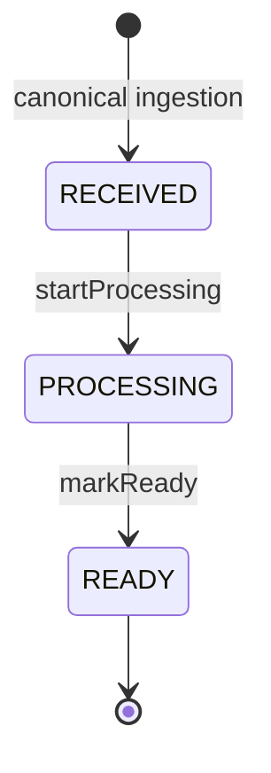

# Order Lifecycle

The domain model and PostgreSQL constraints currently support the successful
processing path below.

`READY` means that the canonical order has passed the asynchronous processing
boundary and is ready for downstream integrations. It does not claim payment,
inventory, fulfillment, or shipment completion.

Transitions are explicit domain operations. Starting processing from any state
other than `RECEIVED`, or marking an order ready from any state other than
`PROCESSING`, is rejected. PostgreSQL applies the same bounded status set to
orders and timeline entries.

The Kafka consumer does not invoke these transitions yet, so orders received
through the current HTTP API remain `RECEIVED`. Failure and retry states will be
documented only when their behavior is implemented.
