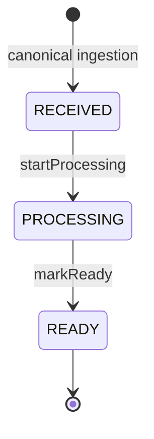
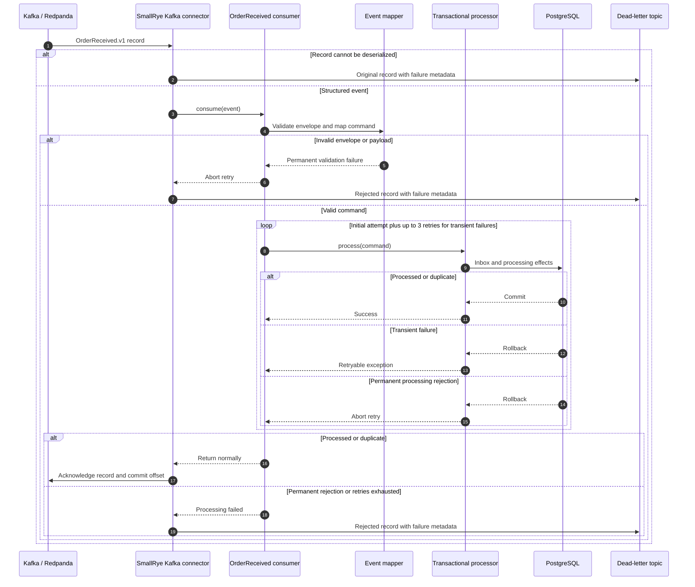

# Order Lifecycle

The domain model and PostgreSQL constraints support the successful processing
path below.

`READY` means that the canonical order has passed the asynchronous processing
boundary and is ready for downstream integrations. It does not claim payment,
inventory, fulfillment, or shipment completion.

Transitions are explicit domain operations. Starting processing from any state
other than `RECEIVED`, or marking an order ready from any state other than
`PROCESSING`, is rejected. PostgreSQL applies the same bounded status set to
orders and timeline entries.

The Kafka consumer executes this path after receiving `OrderReceived.v1`. Inbox
deduplication, the state transitions, processing attempt, timeline entries, and
the pending `OrderReady.v1` outbox event share one PostgreSQL transaction. A
duplicate event is a successful no-op.

## Kafka processing

Each retry enters the transactional processor again and therefore starts a new
transaction. Transient failures wait 500 milliseconds with up to 100
milliseconds of jitter. Invalid events and deterministic processing rejections
are not retried. After a permanent rejection or exhausted retries, the connector
publishes the record to `integration.order.received.dlq.v1`.

Retry and dead-letter handling are message lifecycle concerns, not order
statuses. A rolled-back attempt leaves the order in its previously committed
state; there is no `FAILED` order state in the current model.
