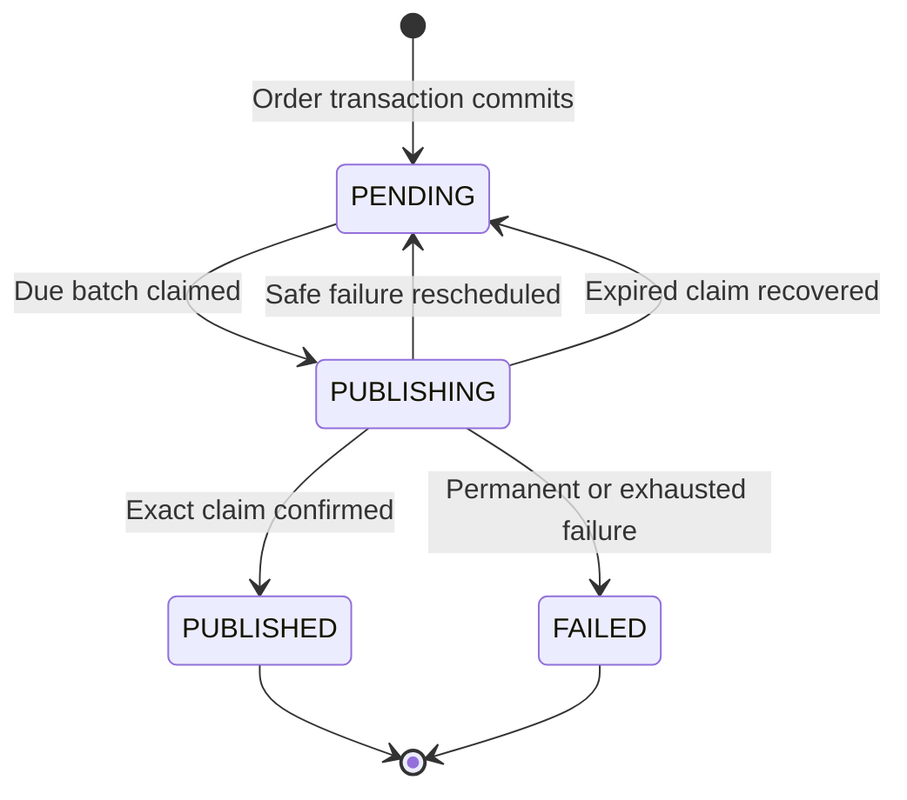
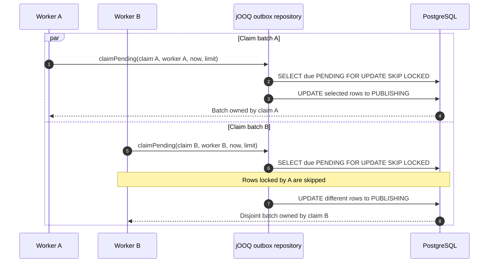
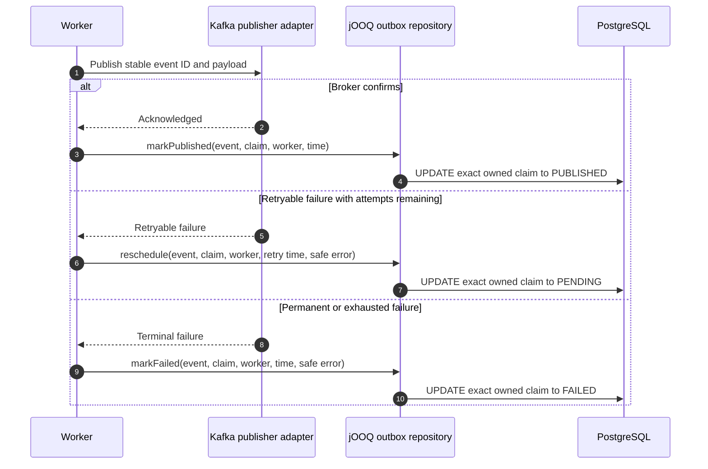
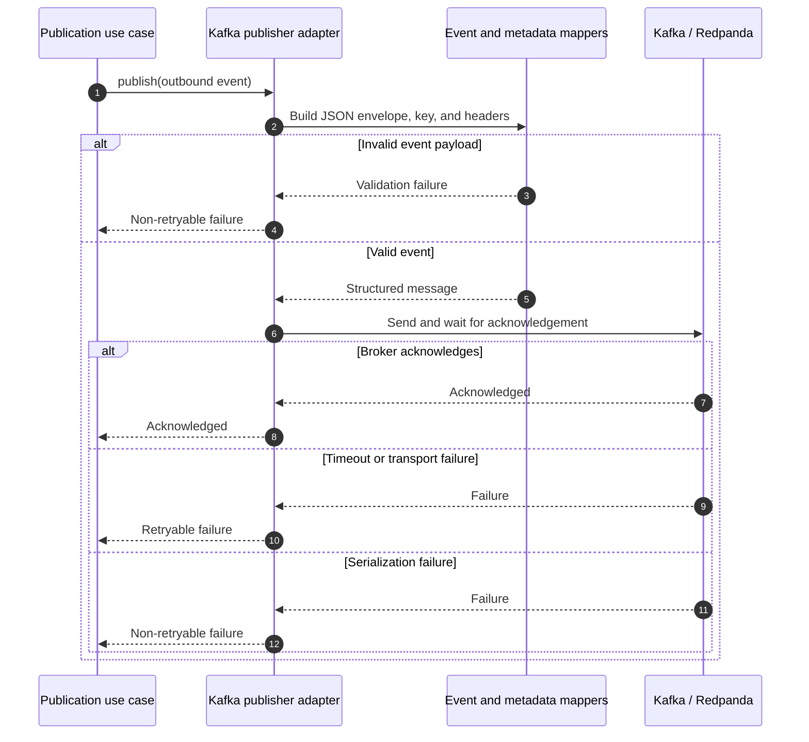
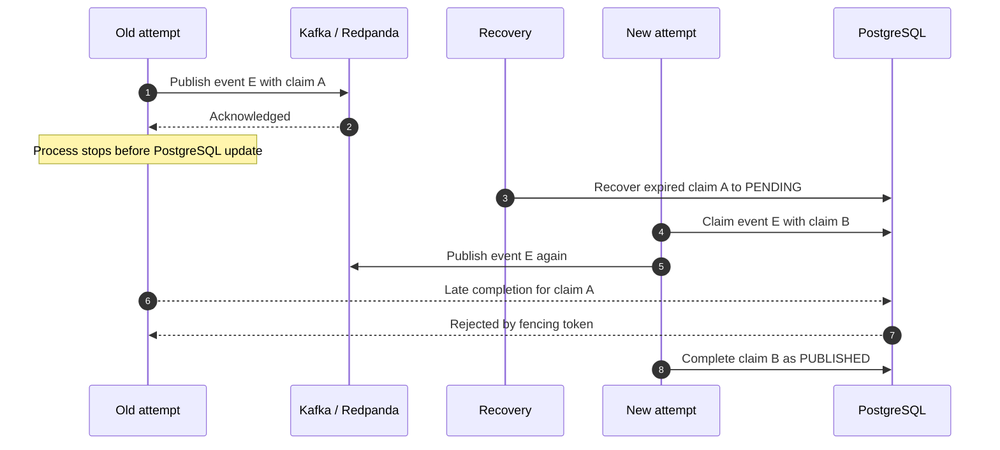

# Outbox Claim Lifecycle

These diagrams describe the implemented PostgreSQL claim lifecycle, Kafka
publication adapter, scheduled dispatch cycle, and scheduled expired-claim
recovery.

## State machine

Completion, rescheduling, and terminal failure must match the event ID, worker
ID, and random claim ID. The claim ID changes on every attempt and fences late
results. Recovery instead selects only claims older than the configured timeout.

## Concurrent claim

The database transaction ends before any future broker call.

## Completion and retry

The repository rejects all three owned transitions if ownership has changed.

## Kafka adapter boundary

Kafka request, delivery, and adapter timeouts are 8, 10, and 12 seconds
respectively. The standard component test uses the SmallRye in-memory connector;
a dedicated integration test uses Redpanda through Kafka Dev Services to verify
the real serialization and transport configuration.

## Retry policy

The application policy uses bounded exponential backoff with equal jitter. The
delay limit doubles after each failed attempt up to a configured maximum, while
the actual delay is sampled between 50% and 100% of that limit. Once the maximum
attempt count is reached, the decision is `Exhausted` rather than another retry.

The policy and terminal transition are implemented, but the publisher
orchestrator and production configuration are not connected yet.

## Expiry and ambiguous publication

The broker may observe event `E` twice. This is an at-least-once boundary, so the
consumer increment must record the stable event ID and apply its business effect
only once.
