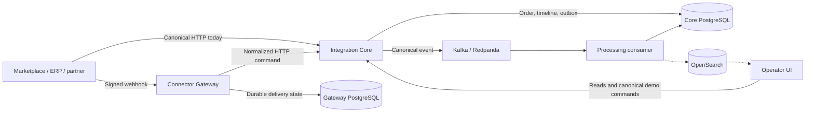

# Product and Integration Overview

## Purpose

Commerce Integration Hub is a B2B platform for receiving orders from
marketplaces, ERPs, and partner systems and turning them into a canonical,
traceable processing flow. It focuses on reliable integration boundaries rather
than checkout, payment, or inventory features.

The platform is designed to make duplicate deliveries, ambiguous timeouts,
temporary outages, and permanent failures explicit and recoverable. Operators
can follow an order across ingestion and asynchronous processing through line
items, timeline entries, and processing attempts. Search projections and
controlled production retries remain later increments. The current operator API
exposes read-only order summary and detail views backed by the authoritative
PostgreSQL state, and the console also provides a controlled local ingestion
simulator.

## Problem

External systems use different payloads and delivery mechanisms. They may retry
the same request, reuse identifiers with different content, stop responding
mid-flow, or become temporarily unavailable. Without a shared integration
boundary, these conditions can create duplicate business effects and make
production diagnosis dependent on unrelated service logs.

The hub provides one authoritative order identity, deterministic duplicate
classification, durable event creation, safe retry boundaries, and correlation
metadata for investigation.

## Actors

| Actor | Responsibility |
| --- | --- |
| External source system | Submits or exposes provider-specific order data. |
| Integration operator | Inspects orders, failures, timelines, and controlled retries. |
| Platform engineer | Operates the services and investigates backlog, lag, and failed events. |
| Downstream service | Consumes canonical events and applies an idempotent business effect. |

An optional public tracking view may later expose a restricted customer-safe
status without internal errors, integration metadata, or operator controls.

## End-to-end Flow

Solid connections are available in the current repository. Dashed connections
represent planned increments and must not be interpreted as implemented runtime
behavior.

## Synthetic Providers

The repository uses two fictional external providers. They contain synthetic
data and are not references to real companies, customers, or commercial
products:

- `MARKETPLACE_A` represents a marketplace that pushes signed order webhooks;
- `ERP_B` represents an Enterprise Resource Planning (ERP) system that exposes
  a cursor-paginated order API and must be polled by the Connector Gateway.

An ERP commonly coordinates business processes such as orders, inventory,
purchasing, sales, invoicing, accounting, production, and logistics. This
project models only its order-export boundary; it does not attempt to implement
an ERP. The generic identifiers keep the demonstration independent from real
provider brands while contrasting push and pull integration behavior.

## Integration Modes

### Canonical HTTP API

Available today. An administrator provisions a source credential, and the
source calls the versioned order API using that credential. The service derives
source ownership from authentication, validates the canonical payload, and
classifies repeated submissions as equivalent or conflicting.

The committed OpenAPI contract documents `POST /api/v1/orders` and
`GET /api/v1/orders/{id}`. Optional correlation IDs are propagated through HTTP,
persistence, and structured logs.

### Operator API and demo console

Available for the current PostgreSQL-backed scope. The Integration Core exposes
read-only operator endpoints for paginated order summaries and order details
with line items, timeline entries, and processing attempts. The React and
TypeScript console implements the paginated summary, operational detail, and a
demo simulator for sending fresh, equivalent, conflicting, and domain-invalid
canonical orders in a controlled local environment. Published-event inspection
remains planned.

The simulator is a portfolio and development tool, not a production
administration surface. Production replay, manual retries, and mutation of
integration state remain separate audited capabilities.

### Provider-specific Connector Gateway

Implemented for the current `MARKETPLACE_A` webhook path. The Node.js and
TypeScript gateway has a registered
`MARKETPLACE_A` HTTP adapter covering exact raw-body authentication, key
rotation, strict provider validation, canonical mapping, and receipt-command
fingerprinting. Its Kysely-managed PostgreSQL delivery-ledger schema and
constraints are integration-tested. Its transactional repository classifies
first receipts, equivalent replays, and conflicting content under concurrent
requests without replacing the original delivery. The running route composes
authentication, mapping, the receipt use case, and PostgreSQL lifecycle, and
returns `202` only after durable commit. The opt-in worker composes bounded
concurrent claims, fenced attempts, the typed Integration Core HTTP client,
bounded retries, terminal outcomes, expired-lease recovery, metrics, and
graceful shutdown. Compose currently leaves that worker disabled until a source
credential is supplied. The strict `ERP_B` page parser, canonical mapper,
versioned per-item fingerprint, and page classifier are implemented. The
classifier separates forwardable changes from durable poison-item evidence,
collapses equivalent in-page duplicates, and rejects conflicting identities.
Its transactional page repository stores both outcomes and advances the fenced
checkpoint atomically, while equivalent replays remain idempotent and stale
pollers cannot advance it. Pollers acquire an available or expired checkpoint
lease through one conditional database update; concurrent workers cannot both
acquire it. Matching owner/token checks fence renewal and clean release;
renewal cannot revive an expired lease or shorten an existing one. The provider
HTTP adapter is implemented with bounded configuration, bearer authentication,
opaque cursor encoding, timeout/cancellation, manual redirects, bounded streamed
responses, strict page parsing, and typed outcomes. A single-page use case now
composes fetch, classification, poison evidence, and fenced atomic commit while
preserving provider and persistence failures. The bounded multi-page runner
acquires and releases ownership, renews only before another page, aggregates
durable progress, and stops cleanly at its page limit. Runtime configuration,
and a cancellation-aware non-overlapping scheduler are implemented and opt-in.
Polling outcome metrics are implemented and exposed with bounded labels. The
opt-in process composition and fenced configuration-block persistence are
implemented. A PostgreSQL-backed process test and deterministic Compose provider
verify the complete two-page polling path. The gateway owns
delivery state but does not mutate authoritative order state.

### Event Subscription

Available for the current internal processing scope. The Integration Core
publishes versioned canonical events through Kafka-compatible infrastructure
and processes `OrderReceived.v1` idempotently.
The consumer records attempts and timeline entries transactionally, transitions
successful orders to `READY`, and emits `OrderReady.v1`. Search projection and
external subscribers remain planned.

## Reliability Model

- Order, items, initial timeline entry, and outbox event commit atomically.
- Source identity and external order ID define the business idempotency key.
- A canonical fingerprint distinguishes equivalent replay from conflicting
  content.
- Outbox workers use bounded concurrent claims and fencing tokens.
- Retry decisions use bounded exponential backoff with equal jitter.
- Permanent and exhausted publication failures have a durable terminal state.
- Broker delivery is at-least-once; consumers must be idempotent.

## Capability Status

| Capability | Status |
| --- | --- |
| Canonical order ingestion and retrieval | Implemented |
| Source authentication and source-owned access | Implemented |
| Atomic order, timeline, and outbox persistence | Implemented |
| Outbox claim, retry, recovery, and failure lifecycle | Implemented |
| Kafka publisher adapter | Implemented and broker-tested |
| Scheduled outbox dispatch | Implemented |
| Scheduled expired-claim recovery | Implemented |
| Liveness, database readiness, and Prometheus worker metrics | Implemented |
| Processing consumer and event deduplication | Implemented and broker-tested |
| Operator order summary API | Implemented |
| Operator detail API | Implemented |
| Operator console and demo simulator | Summary, detail, and controlled simulator implemented |
| Provider-specific Connector Gateway | Durable receipt, complete fenced forwarding, and opt-in runtime scheduling implemented |
| `ERP_B` polling foundation | Bounded run, scheduler, metrics, and opt-in process composition implemented |
| OpenSearch projection | Planned |

## Non-goals

- Checkout, payment, inventory, and shipment-carrier processing.
- Replacing business rules owned by source systems.
- Arbitrary user-defined integration workflows.
- End-to-end exactly-once delivery guarantees.
- Production multi-region or Kubernetes deployment in the initial portfolio
  scope.

## Further Reading

- [Local demo](../services/integration-core/README.md#local-demo)
- [Integration Core architecture](../services/integration-core/README.md#architecture)
- [Relational data model](data-model.md)
- [Ingestion sequences](ingestion-sequences.md)
- [Outbox lifecycle](outbox-lifecycle.md)
- [Architecture decisions](decisions/README.md)
- [Current limitations](limitations.md)
