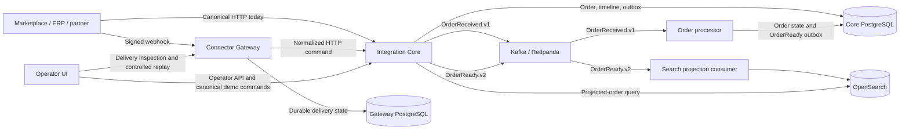

# Product and Integration Overview

## Purpose

Commerce Integration Hub is a B2B platform for receiving orders from
marketplaces, ERPs, and partner systems and turning them into a canonical,
traceable processing flow. It focuses on reliable integration boundaries rather
than checkout, payment, or inventory features.

The platform is designed to make duplicate deliveries, ambiguous timeouts,
temporary outages, and permanent failures explicit and recoverable. Operators
can follow an order across ingestion and asynchronous processing through line
items, timeline entries, processing attempts, and an eventually consistent
search projection. The Core operator API exposes read-only order views backed by
authoritative PostgreSQL state. The Gateway operator API additionally supports
audited replay of eligible exhausted deliveries; outbox and dead-letter replay
remain later increments. The console provides these operational views alongside
a controlled local ingestion simulator, replay of sanitized local flow evidence,
and an interactive static System Map of the implemented topology.

## Problem

External systems use different payloads and delivery mechanisms. They may retry
the same request, reuse identifiers with different content, stop responding
mid-flow, or become temporarily unavailable. Without a shared integration
boundary, these conditions can create duplicate business effects and make
production diagnosis dependent on unrelated service logs.

The hub provides one authoritative order identity, deterministic duplicate
classification, durable event creation, safe retry boundaries, and correlation
metadata for investigation.

## Actors

| Actor | Responsibility |
| --- | --- |
| External source system | Submits or exposes provider-specific order data. |
| Integration operator | Inspects orders, failures, timelines, and controlled retries. |
| Platform engineer | Operates the services and investigates backlog, projection progress, and failed events. |
| Downstream service | Consumes canonical events and applies an idempotent business effect. |

An optional public tracking view may later expose a restricted customer-safe
status without internal errors, integration metadata, or operator controls.

## End-to-end Flow

Every connection in this diagram is implemented. Optional runtime paths remain
disabled unless their documented Compose profile and configuration are enabled.

## Synthetic Providers

The repository uses two fictional external providers. They contain synthetic
data and are not references to real companies, customers, or commercial
products:

- `MARKETPLACE_A` represents a marketplace that pushes signed order webhooks;
- `ERP_B` represents an Enterprise Resource Planning (ERP) system that exposes
  a cursor-paginated order API and must be polled by the Connector Gateway.

An ERP commonly coordinates business processes such as orders, inventory,
purchasing, sales, invoicing, accounting, production, and logistics. This
project models only its order-export boundary; it does not attempt to implement
an ERP. The generic identifiers keep the demonstration independent from real
provider brands while contrasting push and pull integration behavior.

## Integration Modes

### Canonical HTTP API

Available today. An administrator provisions a source credential, and the
source calls the versioned order API using that credential. The service derives
source ownership from authentication, validates the canonical payload, and
classifies repeated submissions as equivalent or conflicting.

The committed OpenAPI contract documents `POST /api/v1/orders` and
`GET /api/v1/orders/{id}`. Optional correlation IDs are propagated through HTTP,
persistence, and structured logs.

### Operator API and demo console

Available for the current PostgreSQL-authoritative scope. The Integration Core
exposes read-only operator endpoints for paginated order summaries and order
details with line items, timeline entries, and processing attempts. The service
can validate externally issued OIDC JWTs and restrict these paths to `operator`
or `platform-admin`; this remains disabled in the default local demo because the
repository does not include an identity provider or token issuer. With the
optional OpenSearch profile enabled,
`GET /api/v1/operator/orders/search` searches the
event-driven order projection by text, source system, external ID, status,
currency, SKU, and receipt interval. `GET /api/v1/operator/orders/search/status`
reports consumer enablement and read-alias availability without mutating the
projection. The React and TypeScript console implements the paginated summary,
operational detail, and an availability-gated projected-order search by text,
exact external order ID, or SKU. It also provides a demo simulator for sending
fresh, equivalent, conflicting, and domain-invalid canonical orders in a
controlled local environment. Published-event inspection remains planned.

The simulator is a portfolio and development tool, not a production
administration surface. Gateway delivery replay is a separate JWT-protected,
audited capability. Outbox and dead-letter replay remain unimplemented.

### System Map

Available as static architecture reference in the Operator Console. The map
shows the implemented runtime topology, direct canonical HTTP ingestion,
provider-specific Gateway paths, durable stores, event processing, optional
local capabilities, and operational touchpoints. Selecting a component exposes
its role, interfaces, and a repository reference. It neither reports
live runtime state nor invokes operational commands.

### Provider-specific Connector Gateway

Implemented for two synthetic providers. For `MARKETPLACE_A`, the Node.js and
TypeScript Gateway verifies the webhook signature against the original request
bytes, validates the provider format and maps it to the common order model.
It returns `202` only after saving the delivery in its own PostgreSQL database.
Equivalent requests retain the original delivery identity; conflicting content
for that provider event returns `409`.

For `ERP_B`, the Gateway polls a cursor-based order API. It saves accepted items,
records rejected items and advances the page checkpoint in one transaction.
Exclusive, time-limited ownership and token checks prevent an expired poller
from changing a checkpoint owned by another worker. Provider authentication
failures block further polling for that connector.

A separate forwarding worker sends saved orders to the Core, records each
attempt and applies bounded retries or terminal outcomes. The Gateway owns
delivery state; the Core owns authoritative order state. Forwarding and polling
are disabled by default in Compose. Forwarding requires a provisioned Core
source credential. HTTP timeouts, response-size limits, concurrency controls
and metrics are implemented and covered by local integration and process tests.
See the [Gateway guide](../services/connector-gateway/README.md),
[delivery lifecycle](gateway-delivery-lifecycle.md) and
[polling diagrams](erp-b-polling.md) for their detailed policies.

### Event Subscription

Available for the current internal processing scope. The Integration Core
publishes versioned canonical events through Kafka-compatible infrastructure
and processes `OrderReceived.v1` idempotently.
The consumer records attempts and timeline entries transactionally, transitions
successful orders to `READY`, and emits `OrderReady.v2` with the order aggregate
version. The OpenSearch order-search projection is implemented as a rebuildable
read model; external subscribers remain planned.

## Reliability Model

- Order, items, initial timeline entry, and outbox event commit atomically.
- Source identity and external order ID define the business idempotency key.
- A canonical fingerprint distinguishes equivalent replay from conflicting
  content.
- Outbox workers use bounded concurrent claims and fencing tokens.
- Retry decisions use bounded exponential backoff with equal jitter.
- Permanent and exhausted publication failures have a durable terminal state.
- Broker delivery is at-least-once; consumers must be idempotent.

## Capability Status

| Capability | Status |
| --- | --- |
| Canonical order ingestion and retrieval | Implemented |
| Source authentication and source-owned access | Implemented |
| Atomic order, timeline, and outbox persistence | Implemented |
| Outbox claim, retry, recovery, and failure lifecycle | Implemented |
| Kafka publisher adapter | Implemented and broker-tested |
| Scheduled outbox dispatch | Implemented |
| Scheduled expired-claim recovery | Implemented |
| Liveness, database readiness, metrics, and local operations dashboard | Implemented |
| Processing consumer and event deduplication | Implemented and broker-tested |
| Operator order summary API | Implemented |
| Operator detail API | Implemented |
| Operator console and demo simulator | Summary, detail, availability-gated projected-order search, authenticated Gateway delivery inspection, and controlled simulator implemented |
| Integration Flow Explorer | Sanitized local evidence replay implemented |
| Integration System Map | Interactive static topology reference with technical links implemented |
| Provider-specific Connector Gateway | Durable receipt, complete fenced forwarding, and opt-in runtime scheduling implemented |
| `ERP_B` polling adapter | Implemented and process-tested |
| OpenSearch projection, operator search API, outcome metrics, availability API, bounded reconciliation, safe full reindex, and persisted projection progress | Implemented; an authenticated/audited reindex command and Kafka consumer lag remain planned |
| Gateway and event API contracts | Generated Gateway OpenAPI with a drift check and a committed, manually maintained canonical-event AsyncAPI implemented |
| Operator authentication and authorization | Opt-in external JWT validation and operator/platform-admin roles implemented for current Core and Gateway operator APIs; an optional protected Helm profile is verified through real HTTP on the local cluster; the Console keeps a manually supplied JWT in page memory only |
| Failure inspection and controlled recovery | Gateway inspection, immutable command audit, and authenticated platform-admin replay implemented, including the Console recovery control for eligible exhausted deliveries |
| Gateway payload retention enforcement | Opt-in bounded terminal-only cleanup, safe replay expiry checks, metrics and PostgreSQL concurrency/process acceptance implemented; disabled by default, with active work retained beyond expiry |
| Distributed tracing and alerting | OpenTelemetry propagation/export with local Collector redaction and Jaeger viewing implemented; tested alert rules, outbox backlog gauges, and a local Alertmanager without receivers implemented |
| Local Kubernetes environment | Implemented with replicas, synchronous PostgreSQL replication, an optional ambient service mesh and failure checks; runs on one machine |

## Non-goals

- Checkout, payment, inventory, and shipment-carrier processing.
- Replacing business rules owned by source systems.
- Arbitrary user-defined integration workflows.
- End-to-end exactly-once delivery guarantees.
- Production deployment, cloud infrastructure and multi-region availability.

## Further Reading

- [Local demo](../services/integration-core/README.md#local-demo)
- [Integration Core architecture](../services/integration-core/README.md#architecture)
- [Relational data model](data-model.md)
- [Ingestion sequences](ingestion-sequences.md)
- [Outbox lifecycle](outbox-lifecycle.md)
- [Architecture decisions](decisions/README.md)
- [Operator Console System Map](../apps/operator-console/README.md#system-map)
- [Current limitations](limitations.md)
