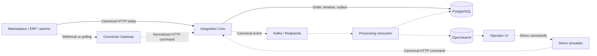

# Product and Integration Overview

## Purpose

Commerce Integration Hub is a B2B platform for receiving orders from
marketplaces, ERPs, and partner systems and turning them into a canonical,
traceable processing flow. It focuses on reliable integration boundaries rather
than checkout, payment, or inventory features.

The platform is designed to make duplicate deliveries, ambiguous timeouts,
temporary outages, and permanent failures explicit and recoverable. Operators
can eventually follow an order across ingestion, asynchronous processing,
search projections, and controlled retries. The current operator API exposes
read-only order summary and detail views backed by the authoritative PostgreSQL
state. The console exposes the paginated summary view; order detail and a
controlled ingestion simulator are the next UI increments.

## Problem

External systems use different payloads and delivery mechanisms. They may retry
the same request, reuse identifiers with different content, stop responding
mid-flow, or become temporarily unavailable. Without a shared integration
boundary, these conditions can create duplicate business effects and make
production diagnosis dependent on unrelated service logs.

The hub provides one authoritative order identity, deterministic duplicate
classification, durable event creation, safe retry boundaries, and correlation
metadata for investigation.

## Actors

| Actor | Responsibility |
| --- | --- |
| External source system | Submits or exposes provider-specific order data. |
| Integration operator | Inspects orders, failures, timelines, and controlled retries. |
| Platform engineer | Operates the services and investigates backlog, lag, and failed events. |
| Downstream service | Consumes canonical events and applies an idempotent business effect. |

An optional public tracking view may later expose a restricted customer-safe
status without internal errors, integration metadata, or operator controls.

## End-to-end Flow

Solid connections are available in the current repository. Dashed connections
represent planned increments and must not be interpreted as implemented runtime
behavior.

## Integration Modes

### Canonical HTTP API

Available today. An administrator provisions a source credential, and the
source calls the versioned order API using that credential. The service derives
source ownership from authentication, validates the canonical payload, and
classifies repeated submissions as equivalent or conflicting.

The committed OpenAPI contract documents `POST /api/v1/orders` and
`GET /api/v1/orders/{id}`. Optional correlation IDs are propagated through HTTP,
persistence, and structured logs.

### Operator API and demo console

Partially available. The Integration Core exposes read-only operator endpoints
for paginated order summaries and order details with line items, timeline
entries, and processing attempts. The React and TypeScript console implements
the paginated order summary view with status filtering. The detail view and
published-event inspection are planned next.

The future console will use those endpoints and include a demo simulator for
sending valid, duplicate, and invalid canonical orders in a controlled local
environment.

The simulator is a portfolio and development tool, not a production
administration surface. Production replay, manual retries, and mutation of
integration state remain separate audited capabilities.

### Provider-specific Connector Gateway

Planned. A Node.js and TypeScript gateway will accept signed proprietary
webhooks and poll cursor-based provider APIs. It will durably record technical
delivery, normalize provider payloads, and call the canonical Kotlin API. The
gateway will own delivery state but will not mutate authoritative order state.

### Event Subscription

In progress. The Integration Core publishes versioned canonical events through
Kafka-compatible infrastructure and processes `OrderReceived.v1` idempotently.
The consumer records attempts and timeline entries transactionally, transitions
successful orders to `READY`, and emits `OrderReady.v1`. Search projection and
external subscribers remain planned.

## Reliability Model

- Order, items, initial timeline entry, and outbox event commit atomically.
- Source identity and external order ID define the business idempotency key.
- A canonical fingerprint distinguishes equivalent replay from conflicting
  content.
- Outbox workers use bounded concurrent claims and fencing tokens.
- Retry decisions use bounded exponential backoff with equal jitter.
- Permanent and exhausted publication failures have a durable terminal state.
- Broker delivery is at-least-once; consumers must be idempotent.

## Capability Status

| Capability | Status |
| --- | --- |
| Canonical order ingestion and retrieval | Implemented |
| Source authentication and source-owned access | Implemented |
| Atomic order, timeline, and outbox persistence | Implemented |
| Outbox claim, retry, recovery, and failure lifecycle | Implemented |
| Kafka publisher adapter | Implemented and broker-tested |
| Scheduled outbox dispatch | Implemented |
| Scheduled expired-claim recovery | Implemented |
| Health checks and Prometheus outbox metrics | Implemented |
| Processing consumer and event deduplication | Implemented and broker-tested |
| Operator order summary API | Implemented |
| Operator detail API | Implemented |
| Operator console and demo simulator | Order summary view implemented; detail and simulator planned |
| Provider-specific Connector Gateway | Planned |
| OpenSearch projection | Planned |

## Non-goals

- Checkout, payment, inventory, and shipment-carrier processing.
- Replacing business rules owned by source systems.
- Arbitrary user-defined integration workflows.
- End-to-end exactly-once delivery guarantees.
- Production multi-region or Kubernetes deployment in the initial portfolio
  scope.

## Further Reading

- [Local demo](../services/integration-core/README.md#local-demo)
- [Integration Core architecture](../services/integration-core/README.md#architecture)
- [Relational data model](data-model.md)
- [Ingestion sequences](ingestion-sequences.md)
- [Outbox lifecycle](outbox-lifecycle.md)
- [Architecture decisions](decisions/README.md)
- [Current limitations](limitations.md)
