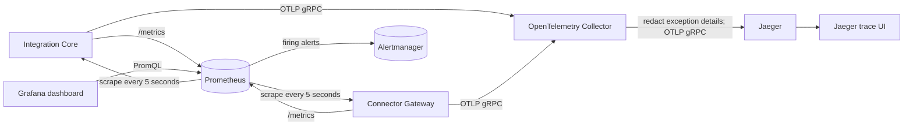

# Local Observability

The optional `observability` Compose profile runs Prometheus, Alertmanager,
Grafana, the OpenTelemetry Collector, and Jaeger for local development and
portfolio demonstrations. It is not a production monitoring topology.



Start the complete topology from the repository root:

```bash
OTEL_SDK_DISABLED=false CONNECTOR_GATEWAY_OTEL_SDK_DISABLED=false docker compose --profile gateway --profile observability up --build -d
```

Start the trace path with tracing enabled in Integration Core:

```bash
OTEL_SDK_DISABLED=false docker compose --profile observability up --build -d integration-core otel-collector jaeger
```

Tracing remains disabled by default. The Jaeger all-in-one service uses
temporary in-memory storage, so its trace history is lost when it stops. The
Collector and Jaeger OTLP receiver are reachable only inside the Compose
network; only the Jaeger UI is published to the host. Before forwarding traces
to Jaeger, the Collector removes `exception.message` and
`exception.stacktrace` from exception events. If the transform fails, it drops
the trace instead of exporting unredacted exception details.

Open [Jaeger](http://localhost:16686) and select the `integration-core`
service. Generate a trace with a request to the service-info endpoint:

```bash
curl http://localhost:8080/api/service-info
```

The automatically instrumented HTTP span should appear after the batch span
processor exports it.

Verify that an unavailable trace backend does not affect the Core's operator
read path:

```bash
./scripts/verify-v1.1-otel-exporter-outage.sh
```

The isolated smoke test enables tracing but deliberately does not start Jaeger.
It checks that the request returns `200`, that its sampled trace context is in
the request log, and that the asynchronous OTLP export failure is logged. The
script removes its containers and volumes when it finishes.

Verify that the Connector Gateway exports Fastify request spans to Jaeger:

```bash
./scripts/verify-v1.1-gateway-tracing.sh
```

The isolated smoke test enables Gateway tracing, calls `/health/live`, and
checks that Jaeger lists `connector-gateway` after receiving the trace through
the Collector. It removes its containers and volumes when it finishes.

## Inspect an operator replay link

For an eligible exhausted delivery, submit a replay from the Operator Console
as a `platform-admin`, then open the attempt's Jaeger link. The replay has a
new trace ID by design. In Jaeger's Trace Timeline, select the
`connector-gateway.delivery.attempt` span, expand **Links (1)** in its details,
and click **`< span in another trace >`** to open the previous attempt. Jaeger
does not show the link type in that label; the stored span link is
`FOLLOWS_FROM`. A link is present only when the previous attempt has complete
persisted trace context.

Start only the metrics services alongside an already running topology:

```bash
docker compose --profile observability up -d prometheus alertmanager grafana
```

- Grafana: [http://localhost:3000](http://localhost:3000)
- Prometheus targets: [http://localhost:9090/targets](http://localhost:9090/targets)
- Prometheus alerts: [http://localhost:9090/alerts](http://localhost:9090/alerts)
- Alertmanager: [http://localhost:9093](http://localhost:9093)
- Jaeger: [http://localhost:16686](http://localhost:16686)

Grafana opens without login because both published ports are bound to localhost
and the profile is intended only for local use. The provisioned data source and
dashboard are read-only; change their version-controlled files instead of
editing them in the UI. Prometheus retains local samples for 24 hours.

Services that are not running appear as `DOWN` targets. This does not prevent
Prometheus or Grafana from starting.

## Alerts

[`prometheus/alerts.yml`](prometheus/alerts.yml) holds the alert rules for the
Core and the Gateway, each with a `page` or `ticket` severity and a section in
the [alert runbook](../docs/runbooks/alerts.md). The same file is meant for the
local Kubernetes environment. Every rule is tested with `promtool`:

```bash
docker run --rm --entrypoint promtool -v "$PWD/observability/prometheus:/rules:ro" \
  prom/prometheus:v3.15.0 test rules /rules/alerts.test.yml
```

In the local Kubernetes environment the same rules run in a Prometheus that
discovers the application pods (see [`deploy/README.md`](../deploy/README.md));
`HubNoTargets` exists for the case where discovery finds no pod at all.

Alertmanager ([`alertmanager/alertmanager.yml`](alertmanager/alertmanager.yml))
groups and shows the alerts but sends them nowhere; a receiver is the only
thing to add to deliver them. The thresholds are demonstrative, since the Hub
has no load test or production traffic to calibrate them.

## Outbox backlog

The Core reports its outbox backlog from PostgreSQL every 15 seconds:

- `integration_hub_outbox_backlog_events`: events waiting to be published
  (pending or claimed by a publisher);
- `integration_hub_outbox_backlog_oldest_age_seconds`: how long the oldest of
  them has waited, or 0 when none waits;
- `integration_hub_outbox_failed_events`: events that failed terminally and will
  not be published without an operator.

They describe the shared database, so every Core replica reports the same
values: aggregate them with `max`, not `sum`. A failed refresh makes them NaN,
so that a stale value never looks current.

## Search projection progress

The operations dashboard exposes two gauges for the OpenSearch order
projection after its watermark advances successfully:

- **Processing delay**: elapsed time from the source event occurrence to the
  successful projection.
- **Watermark age**: elapsed time since the most recently advanced watermark.

Both are empty until the first successful projection and remain a view of
successful projection progress, not Kafka consumer lag. A quiet source makes
the watermark age increase even when the consumer is healthy and has no
backlog.

## Reproducible smoke test

Run the release-level smoke test from any directory:

```bash
./scripts/verify-v0.6-compose.sh
```

The script requires Docker, `curl`, and `jq`. It builds the Integration Core,
starts an isolated Compose project on dedicated high ports, enables the
deterministic ERP_B polling path, and verifies application readiness, both
Prometheus targets, durable polling evidence, and Grafana provisioning. It then
removes its containers, network, and volumes.

Set `KEEP_SMOKE_STACK=true` to retain the isolated stack for inspection after a
run, including for failure diagnosis. The script never reuses the ordinary
development volumes.
