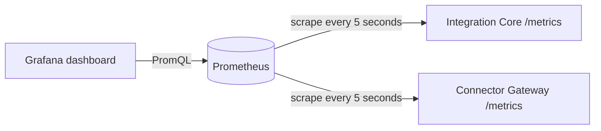

# Local Observability

The optional `observability` Compose profile runs Prometheus and Grafana for
local development and portfolio demonstrations. It is not a production
monitoring topology.



Start the complete topology from the repository root:

```bash
docker compose --profile gateway --profile observability up --build -d
```

Or start only the monitoring services alongside an already running topology:

```bash
docker compose --profile observability up -d prometheus grafana
```

- Grafana: [http://localhost:3000](http://localhost:3000)
- Prometheus targets: [http://localhost:9090/targets](http://localhost:9090/targets)

Grafana opens without login because both published ports are bound to localhost
and the profile is intended only for local use. The provisioned data source and
dashboard are read-only; change their version-controlled files instead of
editing them in the UI. Prometheus retains local samples for 24 hours.

Services that are not running appear as `DOWN` targets. This does not prevent
Prometheus or Grafana from starting.

## Reproducible smoke test

Run the release-level smoke test from any directory:

```bash
./scripts/verify-v0.6-compose.sh
```

The script requires Docker, `curl`, and `jq`. It builds the Integration Core,
starts an isolated Compose project on dedicated high ports, enables the
deterministic ERP_B polling path, and verifies application readiness, both
Prometheus targets, durable polling evidence, and Grafana provisioning. It then
removes its containers, network, and volumes.

Set `KEEP_SMOKE_STACK=true` to retain the isolated stack for inspection after a
run, including for failure diagnosis. The script never reuses the ordinary
development volumes.
